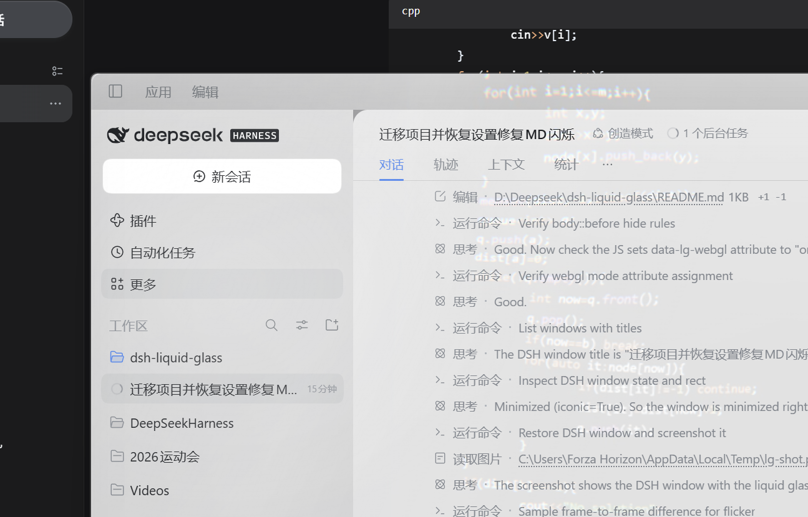

<div align="center">

[中文](README.md) · **[English](README.en.md)**

# DSH Theme Engine

**One plugin, three background modules: Liquid Glass, Wallpaper Engine, and elysia395 compatibility.**

[](https://github.com/ShuoweiFu/DSH-Theme-Engine/tags)
[](LICENSE)
[](#compatibility--limits)
[](https://github.com/ShuoweiFu/DSH-Theme-Engine/stargazers)

</div>



<p align="center"><sub>Real screenshot: wallpaper, liquid glass, settings page and frosted composer working together.</sub></p>

---

## Overview

DSH Theme Engine is the theme engine for DeepSeek Harness. It mirrors your desktop — or the wallpaper Wallpaper Engine is currently playing — live behind the DSH window, so panels, the sidebar, the composer and text all appear to float on glass.

The plugin hosts three switchable background modules: **Liquid Glass** (built in), **Wallpaper Engine** (reads your local Steam / Wallpaper Engine library), and **elysia395 compatibility** (only appears when the elysia395 plugin is detected). They are mutually exclusive — one background module runs at a time. **Dynamic Island** is an independent overlay and can stay on alongside any background module.

Blur is done by a GPU **shader**: WebGL and WebGPU share the same **13-tap Poisson-kernel Gaussian**, ping-ponged across passes to reach large radii. There is no pure-CSS render mode, and no CSS `filter` pretending to be frosted glass.

The plugin registers no agent tools and injects no prompt text, so it adds **zero model token overhead**.

Current version **v.26.11.21.173500**.

## Contents

<table>
  <tr>
    <td width="50%" valign="top">
      <ul>
        <li><a href="#highlights">Highlights</a> · <a href="#settings-and-background-modules">Settings &amp; modules</a></li>
        <li><a href="#hardware-tiers">Hardware tiers</a> · <a href="#quick-start">Quick start</a></li>
        <li><a href="#usage">Usage</a> · <a href="#settings-reference">Settings</a></li>
        <li><a href="#performance-baseline">Performance</a> · <a href="#compatibility--limits">Compatibility</a></li>
        <li><a href="#development">Development</a> · <a href="#repository-layout">Repository layout</a></li>
      </ul>
    </td>
    <td width="50%" valign="top">
      <ul>
        <li>Version: <code>v.26.11.21.173500</code></li>
        <li>Platform: Windows 10 20348+ / Windows 11</li>
        <li>Host: DeepSeek Harness desktop</li>
        <li>License: <a href="LICENSE">Apache-2.0</a></li>
      </ul>
    </td>
  </tr>
</table>

## Highlights

- **Wallpaper & capture**: a resident `Windows.Graphics.Capture` stream at 8 fps, encoding only when the frame actually changes — idle desktop means zero encoding and zero redraws. Supports Wallpaper Engine Scene / Video wallpapers, still images, local videos, and animated gif / apng.
- **Occluded-window compositing**: browsers, editors and players sitting under DSH are cropped in screen space and pasted back behind the glass — no need to move them aside. Rounded corners and transparent regions are composited with premultiplied alpha, so no black edges.
- **Shader blur**: 1–4 ping-pong passes of the 13-tap kernel on WebGL; a dedicated WGSL blur prepass on WebGPU. At maximum `Background blur` you get a wide, smooth falloff instead of a clamped CSS blur.
- **Live wallpapers**: local video and gif / apng upload frames at ~9 fps (`texSubImage2D` / `copyExternalImageToTexture`), so the scene behind the glass keeps moving; frame upload stops instantly when the page is hidden or paused.
- **Three background modules**: Liquid Glass / Wallpaper Engine / elysia395 compatibility, mutually exclusive; Dynamic Island is an independent overlay.
- **Per-module appearance**: every background module stores its own copy of blur, saturation, flow, colour mode, custom colour, auto-invert and ink, plus its own set of four colour-mode buckets. Switching modules never overwrites the other one, and Wallpaper Engine can additionally turn off `Enable liquid glass` to show the raw wallpaper.
- **Four appearance modes**: Auto / Light / Dark / Custom / Intelligent. Intelligent sampling picks a dominant colour from the wallpaper behind (image, video or live desktop capture), tints the glass with it, and switches light/dark at 0.62 / 0.34 luminance thresholds. Mode changes animate over 240 ms, and manual edits cut the animation short.
- **Wallpaper centre**: reads your local Steam / Wallpaper Engine library (detects video, scene and web projects) and applies a video wallpaper with one click; WE entries carry a golden `WE` badge. Scene and web wallpapers are played by WE and captured from the desktop. The settings panel only offers a focused picker — status line, search, type filters, thumbnail grid, one-click apply and custom files — WE's own properties, presets and playback controls stay in Wallpaper Engine.
- **Immersive audio**: a local playlist (mp3 / flac / wav / ogg / m4a / aac / opus, 1.0–2.0× speed, volume) or system audio capture (analysis only, never replayed). Audio energy feeds the shader, so bass hits ripple the surface and breathe the highlights.
- **Adaptive ink**: switches between dark and light text by background luminance (WCAG 7:1 target); a manual choice is never overwritten.
- **Two backends**: WebGL (best compatibility) / WebGPU (experimental). If WebGPU is unavailable the plugin falls back to WebGL without errors or a black screen.
- **Performance guard**: iGPU Survival / dGPU Balanced / Vulcan Beast presets; over-budget frame time → lower resolution → disable occluded compositing → static translucent scrim → auto-disable, five layers of protection.
- **Native main view**: the sidebar gains a single `Theme Engine` row; clicking it renders the settings page full-page in the main workspace like the native Plugins page, and a refresh returns to the conversation.

## Settings and background modules

Click **Theme Engine** in the sidebar to open the settings page in the main workspace. The top offers five tabs:

| Tab | Contents |
| --- | --- |
| Liquid Glass | Appearance controls (wallpaper switch, blur, saturation, tint, frost, dim, flow) + the four appearance modes + rendering & status |
| Wallpaper Engine | `Enable liquid glass` switch + the same appearance controls (stored in the wallpaper module's own copy) + wallpaper centre + immersive audio |
| elysia395 compatibility | Only appears when the elysia395 wallpaper plugin is detected; its settings will be taken over here |
| Dynamic Island | Independent overlay switch; never replaces the active background module |
| Plugin manager | Version, GitHub / npm links, update check (npm / git / GitHub channels) and wallpaper status |

The first three tabs are mutually exclusive background modules; Dynamic Island is independent.

## Hardware tiers

The plugin silently reads the GPU name at startup (`WEBGL_debug_renderer_info`, local only, never uploaded) and applies the tier below. **Read the table before raising the frame cap.**

| GPU | Detection | Default preset | Backend | FPS | Dynamic resolution | Occluded compositing |
| --- | --- | --- | --- | --- | --- | --- |
| Intel Iris Xe / UHD / HD, AMD Radeon / Vega APU, Apple M series | `Intel`, `Iris`, `UHD`, `Radeon Graphics`, `Vega`, `Apple M*` | 🛡 iGPU Survival | WebGL | 30 FPS | ✅ | ✅ |
| Unknown / VM / software rendering | `SwiftShader`, `llvmpipe`, `Microsoft Basic Render` | 🛡 iGPU Survival | WebGL | 30 FPS | ✅ | ✅ |
| GTX 10 / 16, RTX 20 / 30, RX 5000–7000, Arc A | `GTX`, `RTX 20/30`, `RX 5xxx–7xxx` | ⚖ dGPU Balanced | WebGL | 60 FPS | ✅ | ✅ |
| RTX 40 / 50, RX 9000, Arc B, RTX A | `RTX 40xx/50xx`, `RX 9xxx` | 🔥 Vulcan Beast | WebGPU (falls back to WebGL) | 144 FPS | ❌ | ✅ |

> What actually happens when you force high FPS on an iGPU: i7-12700H + Iris Xe + 10 GB LPDDR5, frame cap removed and dynamic resolution disabled — 10 minutes of continuous rendering pushed the GPU to 96 °C, followed by a blue screen. An iGPU has no dedicated VRAM; every frame above 40 FPS is just heat. The plugin therefore applies a tier on first launch, warns when you exceed the safe cap, and falls back to a safe profile after 5 s over budget or on `webglcontextlost`.

## Quick start

Requirements: **Windows 10 20348+ / Windows 11** and the **DSH desktop app**. Building the client needs only Node.js (no third-party dependencies); compiling the native helper needs `clang++` from MSYS2 UCRT64.

**Install (GitHub Release archive)**

Download the latest `.tgz` from [Releases](https://github.com/ShuoweiFu/DSH-Theme-Engine/releases) and install it in DSH:

```
plugin_manager install_bundle target="<path to downloaded tgz>"
```

**Install (from source)**

```powershell
git clone https://github.com/ShuoweiFu/DSH-Theme-Engine.git
```

Install the cloned directory as a bundle in DSH:

```
plugin_manager install_bundle target="<absolute path to the clone>"
```

Refresh the page; a **Theme Engine** row appears in the sidebar. Click it to open the settings page in the main workspace.

**Build**

```powershell
pnpm build:client    # client/src/*.js → client/client.js
pnpm build:capture   # tools/capture/lg-capture.cpp → bin/lg-capture.exe (maintainers only)
```

- `build:client` only needs Node.js; the built artifact is committed, so run it after UI changes.
- `build:capture` needs `clang++` (override with the `LG_CLANG` env var); regular users never compile — `bin/lg-capture.exe` ships with the repo.

## Usage

1. Click **Theme Engine** in the sidebar; the settings page fills the main workspace.
2. Pick a background module at the top: Liquid Glass or Wallpaper Engine (plus the elysia395 tab when it is detected).
3. Tune appearance and the four colour modes in the current branch; each background module keeps its own copy, so switching back restores it.
4. In the Wallpaper Engine branch pick a WE wallpaper or a local file; turning off `Enable liquid glass` shows the raw wallpaper.
5. Everything applies instantly and persists; a refresh returns to the conversation and settings survive.

## Settings reference

| Group | Item | Default | Notes |
| --- | --- | --- | --- |
| Background module | Background module | Liquid Glass | Liquid Glass / Wallpaper Engine / elysia395 compatibility; mutually exclusive |
| Background module | Dynamic Island | Off | Independent overlay, not part of the exclusivity |
| Appearance (per module) | Background blur | 10 px | 0 px = pixel-sharp; radius comes from the shader's multi-pass 13-tap kernel |
| Appearance (per module) | Saturation | 1.4 | Colour richness of the glass layer |
| Appearance (per module) | Glass tint | 55% | Shifts colour temperature and frost bias only |
| Appearance (per module) | Frost | 34% | The only thickness control: 0% = bare glass, 100% = thickest frost |
| Appearance (per module) | Text colour | Auto | Switches dark/light text by background luminance (WCAG 7:1); manual choice is kept |
| Appearance (per module) | Colour mode | Auto | Light / Dark / Custom / Intelligent; Intelligent tints from the wallpaper's dominant colour |
| Appearance (per module) | Custom colour | #8ab4ff | Glass base colour for the Custom mode |
| Appearance (per module) | Auto light/dark | On | Switches light/dark for Auto and Intelligent modes |
| Appearance (per module) | Wallpaper dim | 8% | Slightly dims very bright wallpapers to keep text legible |
| Appearance (per module) | Liquid flow | 0.9 | At 0 the renderer becomes on-demand and idles when the pointer stops |
| Wallpaper Engine | Enable liquid glass | On | Turn off to show the raw wallpaper without the glass layer |
| Wallpaper Engine | WE library | Auto | Scans Steam `libraryfolders.vdf` and `workshop/431960/*/project.json`; video wallpapers become the background |
| Wallpaper Engine | Local file | — | Image / video / gif / apng; video and animated images stream over Range and re-upload every 110 ms |
| Immersive audio | Playlist | — | Local audio files looped in order; 1.0–2.0× speed and volume |
| Immersive audio | System audio | — | Requires browser audio-share permission; analysis only, never replayed |
| Performance | Preset | Auto (by GPU) | iGPU Survival / dGPU Balanced / Vulcan Beast |
| Performance | Render backend | WebGL | WebGL (recommended) / WebGPU (experimental) |
| Performance | Max FPS | 30 / 60 / 144 by tier | Unlimited is only offered on high-end dGPUs |
| Performance | Dynamic resolution | On | Over-budget frame time → 1.0 → 0.8 → 0.65 → 0.5 |
| Performance | Composite occluded windows | By tier | Disabling saves 0.02–0.06 s per capture |
| Performance | Wallpaper refresh | Auto | Resident capture stream (8 fps by default): encode on change; digest check every 0.22 s; 420 ms cross-fade |

## Performance baseline

| Item | Value (i7-12700H / Iris Xe / 2520×1680@150%) |
| --- | --- |
| Single frame (1680×1119, scale 1.0) | **16.9 ms** |
| Single frame (1344×895, scale 0.8, default tier) | **≈10–11 ms** |
| Plugin VRAM delta | **20–25 MB** (6.8 MB textures + 1.7 MB blur buffers + back buffers) |
| Resident GPU memory (A/B) | 286 MB on / 275 MB off |
| Capture frame (WGC readback + composite + JPEG) | **≈32 ms average** (15–60 ms), capped at 8 fps |
| Desktop composite (cold path / one-shot process) | 78–125 ms; 60–75 ms with occluded compositing off |
| End-to-end (window changes under DSH → glass updates) | **≈0.25–0.4 s** (streaming); zero encoding/redraws when idle |

## Compatibility & limits

- Primary display only; other monitors are not mapped.
- Occluded UWP / DRM / minimised windows may return an empty surface: they are skipped (no black patch) but still listed under `apps`.
- If the GPU crashes completely only a static translucent scrim remains (no refraction or flow); a second crash within 10 minutes disables the plugin automatically.
- Occluded-window compositing is Windows-only for now; other platforms only sync still wallpaper files.
- Borderless capture (`IGraphicsCaptureSession3`) requires Windows 11 / 10 20348+; on older builds the system yellow border returns while the background still refreshes.
- When the window is minimised or fully hidden, Chromium stops the render loop — that is browser behaviour and also a power-saving design.
- The elysia395 compatibility tab is currently a placeholder: it only appears once the elysia395 plugin is detected; settings takeover and migration are still in progress.

## Development

Bug reports, compatibility feedback, documentation fixes and feature PRs are welcome. Please include host / plugin version, OS, GPU model, reproduction steps and sanitised logs.

- [Implementation notes](docs/DETAIL.md): compositing, screen-space mapping, the five protection layers, shader parameters and module data shapes.
- [Repository layout](README.en.md#repository-layout): what each directory is responsible for.
- Build: `node scripts/build-client.mjs`, `node scripts/build-capture.mjs`.

## Thanks

Thanks to every contributor ❤️

<a href="https://github.com/ShuoweiFu/DSH-Theme-Engine/graphs/contributors">
  
</a>

<a href="https://star-history.com/#ShuoweiFu/DSH-Theme-Engine&Date">
  <picture>
    <source media="(prefers-color-scheme: dark)" srcset="https://api.star-history.com/svg?repos=ShuoweiFu/DSH-Theme-Engine&type=Date&theme=dark">
    
  </picture>
</a>

## Repository layout

| Path | Purpose |
| --- | --- |
| `index.js` | Host plugin entry: `/liquid-glass/*` routes, capture scheduling, module state and update check |
| `host/` | Host capabilities: wallpaper detection, WE bridge, resident capture helper, PowerShell fallback, process helpers, update check |
| `client/src/` | Frontend sources, concatenated `01` → `14` (13 = wallpaper centre / appearance modes, 14 = audio matrix) |
| `client/client.js` | Built artifact loaded by DSH through `exports["./client"]` |
| `tools/capture/lg-capture.cpp` | Native capture / compositing helper (WGC + GDI+) |
| `bin/lg-capture.exe` | Prebuilt helper shipped with the plugin |
| `docs/` | Implementation details and screenshots |
| `scripts/` | The two build scripts |

## License

[Apache License 2.0](LICENSE) © DSH Theme Engine contributors

Released under the Apache License 2.0: commercial use, modification and redistribution are permitted provided copyright and license notices are kept; see [LICENSE](LICENSE) and [NOTICE](NOTICE).
