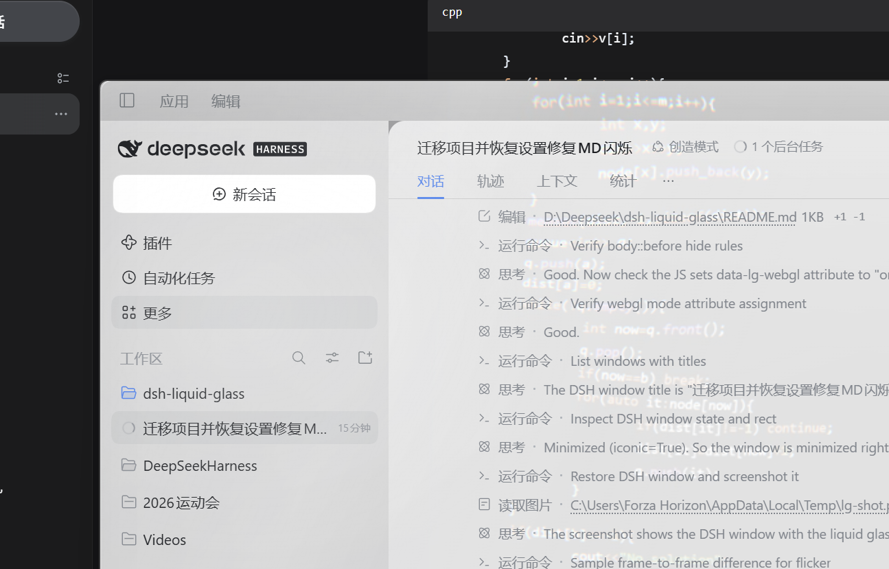

<div align="center">

**[中文](README.md)** · [English](README.en.md)

# DSH Theme Engine

**一个总插件，三种背景模块：液态玻璃、壁纸引擎、elysia395 兼容。**

[](https://github.com/ShuoweiFu/DSH-Theme-Engine/tags)
[](LICENSE)
[](#兼容与限制)
[](https://github.com/ShuoweiFu/DSH-Theme-Engine/stargazers)

</div>



<p align="center"><sub>真实界面截图：壁纸、液态玻璃、设置页与输入框磨砂同步生效。</sub></p>

---

## 简介

DSH Theme Engine 是 DeepSeek Harness 的主题引擎。它把本机桌面（或 Wallpaper Engine 正在播放的壁纸）实时同步到 DSH 窗口背后，再让面板、侧边栏、输入框和文字像悬空在玻璃上。

总插件下挂三种可切换的背景模块：**液态玻璃背景**（内置）、**壁纸引擎**（读取本机 Steam / Wallpaper Engine 壁纸库）和 **elysia395 壁纸引擎兼容**（检测到 elysia395 插件后才出现）。三者互斥，同一时间只有一个在提供背景；**灵动岛**是独立叠加层，可以和任意背景模块同时开启。

模糊由 GPU **Shader** 完成：WebGL / WebGPU 双后端共用同一套 **13-tap 泊松核高斯**，多次 ping-pong 覆盖大半径。没有纯 CSS 渲染模式，也不会用 CSS `filter` 冒充磨砂。

插件不向 agent 注册工具、不注入提示文本，**不增加模型 token 开销**。

当前版本 **v.26.11.21.173500**。

## 目录

<table>
  <tr>
    <td width="50%" valign="top">
      <ul>
        <li><a href="#主要能力">主要能力</a> · <a href="#设置页与背景模块">设置页与背景模块</a></li>
        <li><a href="#硬件档位">硬件档位</a> · <a href="#快速开始">快速开始</a></li>
        <li><a href="#使用">使用</a> · <a href="#设置项">设置项</a></li>
        <li><a href="#性能基线">性能基线</a> · <a href="#兼容与限制">兼容与限制</a></li>
        <li><a href="#开发与贡献">开发与贡献</a> · <a href="#仓库结构">仓库结构</a></li>
      </ul>
    </td>
    <td width="50%" valign="top">
      <ul>
        <li>授时版本：<code>v.26.11.21.173500</code></li>
        <li>平台：Windows 10 20348+ / Windows 11</li>
        <li>宿主：DeepSeek Harness 桌面版</li>
        <li>许可：<a href="LICENSE">Apache-2.0</a></li>
      </ul>
    </td>
  </tr>
</table>

## 主要能力

- **壁纸与捕获**：`Windows.Graphics.Capture` 常驻流，默认 8 fps，只在画面真的变化时编码推帧；桌面静止时零编码、零重绘。支持 Wallpaper Engine 的 Scene / Video 壁纸、静态图片、本机视频与 gif / apng 动态图。
- **遮挡窗口合成**：DSH 下面压着的浏览器、编辑器、播放器按屏幕坐标裁剪后贴回玻璃背后，不用把窗口挪开；圆角与透明区按预乘 alpha 合成，不贴黑边。
- **Shader 模糊**：WebGL 端 1–4 次 ping-pong 的 13-tap 高斯；WebGPU 端独立 WGSL 模糊前置通道。`背景模糊` 拉满时是大半径平滑过渡，不是截断的 CSS blur。
- **活体动态壁纸**：本机视频与 gif / apng 按 ~9 fps 逐帧上传纹理（`texSubImage2D` / `copyExternalImageToTexture`），玻璃后的画面一直在动；页面隐藏或暂停时立即停帧，不空耗 GPU。
- **三种背景模块**：液态玻璃背景 / 壁纸引擎 / elysia395 兼容，互斥三选一；灵动岛是独立叠加层，不参与互斥。
- **外观按模块分开**：每个背景模块各存一份外观参数（模糊、饱和度、液态流动、颜色模式、自定义颜色、自动深浅、墨色）与各自的四象模式桶，切换模块不会互相覆盖；壁纸引擎还可以单独关闭「启用液态玻璃」，只显示原始壁纸。
- **四象外观模式**：自动 / 浅色 / 深色 / 自定义颜色 / 智能取色。智能取色从后方壁纸（图片、视频或实时桌面捕获）取主色给玻璃上色，并按 0.62 / 0.34 亮度阈值自动切浅/深；切模式带 240 ms 过渡，手动调参时动画立即让位。
- **壁纸中枢**：读取本机 Steam / Wallpaper Engine 壁纸库（自动识别视频、场景、网页项目），视频壁纸一键作背景；WE 项目带金色 `WE` 标。场景与网页壁纸由 WE 播放后走实时桌面捕获。设置面板内是一块精简选择器：状态行、搜索、类型筛选、缩略图网格、一键应用与自定义文件，不摆放 WE 本体的属性 / 预设 / 播放控件。
- **声临其境**：本地音频播放列表（mp3 / flac / wav / ogg / m4a / aac / opus，1.0–2.0 倍速，音量可调）；也可捕获系统正在播放的声音（只做分析，不二次播放）。音频能量实时喂给 Shader，低音落下时液面起伏、高光呼吸。
- **自适应文字**：按背景亮度在黑白字之间切换（WCAG 7:1 目标）；手动指定后不再被自动改写。
- **双后端**：WebGL（兼容最好）/ WebGPU（实验）；WebGPU 不可用时自动回落 WebGL，不弹错、不黑屏。
- **性能保护**：核显保命 / 独显均衡 / 火神狂暴三档预设；帧时间超预算 → 降分辨率 → 关遮挡合成 → 静态半透明遮罩 → 自动关闭，五层逐级保命。
- **原生主视图**：侧边栏只多一行「主题引擎」，点开后设置页像原生「插件」页一样整页铺在右侧主工作区；刷新后回到会话。

## 设置页与背景模块

点侧边栏的「主题引擎」进入主工作区整页设置。顶部是五个选项框：

| 选项框 | 内容 |
| --- | --- |
| 液态玻璃背景 | 外观参数（壁纸开关、模糊、饱和度、着色、霜面、压暗、流动）+ 四象外观模式 + 渲染与状态 |
| 壁纸引擎 | 「启用液态玻璃」开关 + 同一套外观参数（存在壁纸模块自己的那一份里）+ 壁纸中枢 + 声临其境 |
| elysia395 兼容 | 仅在检测到 elysia395 壁纸引擎插件后出现；后续会把它的设置接管到这里 |
| 灵动岛 | 独立叠加层开关，不影响当前背景模块 |
| 插件管理 | 版本号、GitHub / npm 直达、检查更新（npm / git / GitHub 三渠道）与壁纸状态 |

前三个背景模块互斥：切到壁纸引擎时液态玻璃模块不再提供背景，反之亦然；灵动岛可以单独开。

## 硬件档位

启动时静默读取显卡型号（`WEBGL_debug_renderer_info`，本地读取、不上传），自动套用下表档位。**先看表再开高帧率。**

| 显卡 | 检测特征 | 默认预设 | 引擎 | 帧率 | 动态降分辨率 | 遮挡合成 |
| --- | --- | --- | --- | --- | --- | --- |
| Intel Iris Xe / UHD / HD，AMD Radeon / Vega APU，Apple M 系列 | `Intel`, `Iris`, `UHD`, `Radeon Graphics`, `Vega`, `Apple M*` | 🛡 核显保命档 | WebGL | 30 FPS | ✅ | ✅ |
| 未知 / 虚拟机 / 软件渲染 | `SwiftShader`, `llvmpipe`, `Microsoft Basic Render` | 🛡 核显保命档 | WebGL | 30 FPS | ✅ | ✅ |
| GTX 10 / 16 系、RTX 20 / 30 系、RX 5000–7000、Arc A 系 | `GTX`, `RTX 20/30`, `RX 5xxx–7xxx` | ⚖ 独显均衡档 | WebGL | 60 FPS | ✅ | ✅ |
| RTX 40 / 50 系、RX 9000 系、Arc B 系、RTX A 系 | `RTX 40xx/50xx`, `RX 9xxx` | 🔥 火神狂暴档 | WebGPU（不可用回落 WebGL） | 144 FPS | ❌ | ✅ |

> 核显强开高帧率的真实结局：i7-12700H + Iris Xe + 10 GB LPDDR5，手动解除帧率限制并关闭动态分辨率，连续渲染 10 分钟后 GPU 96 °C，随后蓝屏。核显没有独立显存，超过 40 FPS 的每一帧只是在发热。插件因此做了三件事：首次启动按显卡套档；手动超上限显示 ⚠；连续 5 秒超预算或 `webglcontextlost` 自动回落安全配置。

## 快速开始

前置：**Windows 10 20348+ / Windows 11**、**DSH 桌面版**。构建客户端只需要 Node.js（无第三方依赖），编译原生助手需要 MSYS2 UCRT64 的 `clang++`。

**安装（GitHub Release 包）**

从 [Releases](https://github.com/ShuoweiFu/DSH-Theme-Engine/releases) 下载最新的 `.tgz`，在 DSH 里安装：

```
plugin_manager install_bundle target="<下载的 tgz 路径>"
```

**安装（源码）**

```powershell
git clone https://github.com/ShuoweiFu/DSH-Theme-Engine.git
```

在 DSH 里把 clone 出来的目录装成 bundle：

```
plugin_manager install_bundle target="<clone 出来的绝对路径>"
```

刷新页面，侧边栏会出现一行 **主题引擎**。点它，设置页进入右侧主工作区。

**构建**

```powershell
pnpm build:client    # client/src/*.js → client/client.js
pnpm build:capture   # tools/capture/lg-capture.cpp → bin/lg-capture.exe（仅维护者需要）
```

- `build:client` 只需要 Node.js；产物已随仓库提交，改 UI 后跑它即可。
- `build:capture` 需要 `clang++`，可用环境变量 `LG_CLANG` 指定；普通用户无需编译，`bin/lg-capture.exe` 已随仓库打包。

## 使用

1. 点击侧边栏 **主题引擎**，设置页整页渲染在右侧主工作区。
2. 顶部选背景模块：液态玻璃背景 / 壁纸引擎（检测到 elysia395 时还会多一个兼容分支）。
3. 在当前分支调外观参数与四象模式；两个背景模块各存一份，切回来还在。
4. 壁纸引擎分支里可以选 WE 壁纸或本机文件；关闭「启用液态玻璃」则只显示原始壁纸。
5. 所有修改即时生效并保存；刷新或重启后回到会话页面，设置不丢。

## 设置项

| 分组 | 项 | 默认 | 说明 |
| --- | --- | --- | --- |
| 背景模块 | 背景模块 | 液态玻璃背景 | 液态玻璃背景 / 壁纸引擎 / elysia395 兼容；互斥 |
| 背景模块 | 灵动岛 | 关 | 独立叠加层，不参与互斥 |
| 外观（按模块各存一份） | 背景模糊 | 10 px | 0 px = 像素级清晰；半径由 shader 的 13-tap 多 pass 完成 |
| 外观（按模块各存一份） | 饱和度 | 1.4 | 玻璃层的色彩浓度 |
| 外观（按模块各存一份） | 玻璃着色 | 55% | 只调色温与霜白偏向，不决定厚度 |
| 外观（按模块各存一份） | 霜面浓度 | 34% | 唯一控制面板厚度的滑条：0% = 裸玻璃，100% = 最厚白霜 |
| 外观（按模块各存一份） | 文字颜色 | 自动 | 按背景亮度在黑白字间切换（WCAG 7:1）；手动选择后不再改写 |
| 外观（按模块各存一份） | 颜色模式 | 自动 | 浅色 / 深色 / 自定义 / 智能取色；智能取色按壁纸主色染玻璃 |
| 外观（按模块各存一份） | 自定义颜色 | #8ab4ff | 「自定义」档的玻璃基色 |
| 外观（按模块各存一份） | 按壁纸自动深浅 | 开 | 「自动」与「智能取色」下按背景亮度切浅/深 |
| 外观（按模块各存一份） | 壁纸压暗 | 8% | 只在壁纸很亮时压一点，避免文字发飘 |
| 外观（按模块各存一份） | 液态流动 | 0.9 | 0 时进入按需渲染，鼠标静止即挂起 |
| 壁纸引擎 | 启用液态玻璃 | 开 | 关掉后只显示原始壁纸，不叠加玻璃层 |
| 壁纸引擎 | WE 壁纸库 | 自动读取 | 扫描 Steam `libraryfolders.vdf` 与 `workshop/431960/*/project.json`；视频壁纸直接作背景 |
| 壁纸引擎 | 本机文件 | — | 图片 / 视频 / gif / apng；视频与动态图走 Range 流式读取，并按 110 ms 拷帧保持流动 |
| 声临其境 | 播放列表 | — | 本机音频文件顺序循环；支持 1.0–2.0 倍速与音量 |
| 声临其境 | 系统音频 | — | 需浏览器授权共享音频；只做律动分析，不二次播放 |
| 性能 | 智能预设 | 自动（跟随显卡） | 核显保命 / 独显均衡 / 火神狂暴 |
| 性能 | 渲染引擎 | WebGL | WebGL（推荐）/ WebGPU（实验） |
| 性能 | 最大帧率 | 按档位 30 / 60 / 144 | 无限制只在高端独显上可选 |
| 性能 | 自动降分辨率 | 开 | 帧时间超预算 → 1.0 → 0.8 → 0.65 → 0.5 |
| 性能 | 合成被遮挡的窗口 | 按档位 | 关掉可省每次截图 0.02–0.06 s |
| 性能 | 壁纸刷新 | 自动 | 常驻捕获流（默认 8 fps）：变化才编码；页面 0.22 s 一次 digest 检查；换图交叉淡入 420 ms |

## 性能基线

| 项目 | 数值（i7-12700H / Iris Xe / 2520×1680@150%） |
| --- | --- |
| 单帧渲染（1680×1119，scale 1.0） | **16.9 ms** |
| 单帧渲染（1344×895，scale 0.8，默认档） | **≈10–11 ms** |
| 插件显存增量 | **20–25 MB**（纹理 6.8 MB + 模糊缓冲 1.7 MB + 后备缓冲） |
| 常驻 GPU 显存（A/B 对比） | 开 286 MB / 关 275 MB |
| 捕获流一帧（WGC 读回 + 合成 + JPEG） | **≈32 ms 均值**（15–60 ms），8 fps 上限 |
| 桌面合成一次（冷路径 / 一次性进程） | 78–125 ms；关掉遮挡合成 60–75 ms |
| 端到端响应（窗口在 DSH 下变化 → 玻璃更新） | **≈0.25–0.4 s**（流式）；桌面静止时零编码、零重绘 |

## 兼容与限制

- 只支持主显示器；多屏时其它屏幕不会被映射。
- 被遮挡的 UWP / DRM / 已最小化窗口可能抓到空表面：跳过不贴黑，`apps` 里仍列出。
- 显卡彻底崩溃时只剩一层静态半透明遮罩（没有折射与流动）；10 分钟内第二次崩溃会自动关闭插件。
- 非 Windows 平台暂不支持「被遮挡窗口合成」，只能同步静态壁纸文件。
- 无边框捕获（`IGraphicsCaptureSession3`）需要 Windows 11 / 10 20348+；更老系统上系统黄框会回来，背景照常刷新。
- 窗口最小化 / 完全不可见时 Chromium 会停掉渲染循环，这是浏览器行为，也是省电设计。
- elysia395 兼容分支目前是占位：检测到 elysia395 插件后才会出现，设置接管与迁移仍在施工。

## 开发与贡献

欢迎提交 Bug 复现、兼容反馈、文档修正和功能 PR。反馈时请附宿主 / 插件版本、操作系统、显卡型号、复现步骤与脱敏日志。

- [实现细节](docs/DETAIL.md)：合成原理、屏幕空间映射、五层保护、着色器参数、模块数据形状。
- [仓库结构](README.md#仓库结构)：每个目录负责什么。
- 构建：`node scripts/build-client.mjs`、`node scripts/build-capture.mjs`。

## 致谢

感谢所有贡献者 ❤️

<a href="https://github.com/ShuoweiFu/DSH-Theme-Engine/graphs/contributors">
  
</a>

<a href="https://star-history.com/#ShuoweiFu/DSH-Theme-Engine&Date">
  <picture>
    <source media="(prefers-color-scheme: dark)" srcset="https://api.star-history.com/svg?repos=ShuoweiFu/DSH-Theme-Engine&type=Date&theme=dark">
    
  </picture>
</a>

## 仓库结构

| 路径 | 作用 |
| --- | --- |
| `index.js` | 宿主插件入口：`/liquid-glass/*` 本地路由、捕获调度、模块状态与更新检查 |
| `host/` | 宿主能力：壁纸识别、WE 桥、常驻捕获助手、PowerShell 回退、运行封装、更新检查 |
| `client/src/` | 前端源码，`01` → `14` 按序拼接（13 = 壁纸中枢/外观模式，14 = 音频矩阵） |
| `client/client.js` | 构建产物，DSH 通过 `exports["./client"]` 加载 |
| `tools/capture/lg-capture.cpp` | 原生捕获/合成助手（WGC + GDI+） |
| `bin/lg-capture.exe` | 预编译助手，随插件分发 |
| `docs/` | 实现细节与截图 |
| `scripts/` | 两个构建脚本 |

## License

[Apache License 2.0](LICENSE) © DSH Theme Engine contributors

本项目基于 Apache License 2.0 发布：允许商用、修改、再分发，需保留版权与许可声明；详见 [LICENSE](LICENSE) 与 [NOTICE](NOTICE)。
