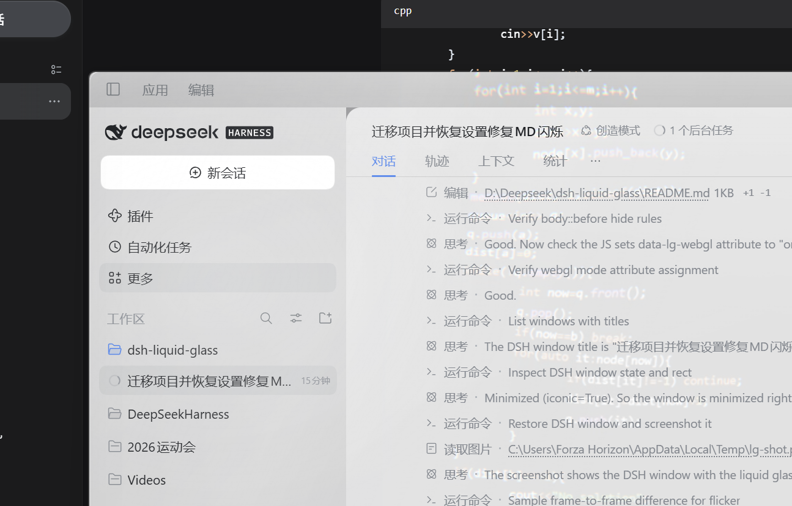

# Liquid Glass 路 娑叉€佺幓鐠?
鎶?**DeepSeek Harness 鐨勮儗鏅崲鎴愪綘妗岄潰澹佺焊鏈韩**锛屽苟鎶婇潰鏉垮彉鎴愪細娴佸姩鐨勫崐閫忔槑鐜荤拑 鈥斺€?鏂囧瓧涓庨潰鏉挎偓绌哄湪娑叉€佺幓鐠冧笂锛岀幓鐠冨悗闈㈠氨鏄闈笂鐪熷疄鐨勯偅寮犲绾搞€?


## 鏍稿績鎬濊矾锛氭槧灏勭湡瀹炲绾革紝鑰屼笉鏄湪绐楀彛閲岄噸鐢讳竴寮?
Web / Electron 鍋氫笉鍒扮湡姝ｇ殑銆岄€忚绐楀彛銆嶏紙鍙湁 macOS 鐨?DWM 绾?API 鎵嶈兘锛夛紝鎵€浠ヨ繖閲岀殑鍋氭硶鏄細**鎶婃闈㈠绾哥殑鍘熷鍍忕礌鎸夊睆骞曞潗鏍囨槧灏勫埌绐楀彛鍐?*銆傜潃鑹插櫒鐢?`uWin` / `uScreen` / `uScale` / `uDpr` 鎶婃瘡涓墖鍏冩崲绠楁垚銆屾闈笂鐨勫摢涓儚绱犮€嶏紝鍐嶅仛鎶樺皠銆佽壊鏁ｄ笌娴佸姩锛屽洜姝ょ獥鍙ｉ噷鐨勭敾闈笌绐楀彛澶栨闈笂鐨勫绾镐弗鏍煎榻?鈥斺€?鎹㈢獥鍙ｄ綅缃€佹敼鍙樼獥鍙ｅぇ灏忋€佸姩鎬佸垎杈ㄧ巼闄嶇骇閮戒笉浼氳鐢婚潰閿欎綅銆?
## 澹佺焊鏉ユ簮浼樺厛绾э紙host 鍗婏級

1. **Wallpaper Engine 瑙嗛澹佺焊锛堟渶浣筹級**锛氳 `wallpaper64.exe` 鐨?`config.json`锛圲TF-8锛屼笉鎸?ANSI 璇伙級锛屽彇 `general.wallpaperconfig.selectedwallpapers.Monitor0.file` 鎸囧悜鐨?mp4/webm锛屽湪 `/liquid-glass/wallpaper` 鐢?HTTP Range 鎻愪緵銆傚鎴风鐢ㄩ殣钘?`<video>` seek 鍒扮害 18% 澶勫彇涓€甯э紙2048 闀胯竟锛宍createImageBitmap` 鍚庝笂浼犵汗鐞嗭級锛屾棦鎷垮緱鍒板绾稿師濮嬬敾闈紝鍙?*瀹屽叏涓嶅惈妗岄潰鍥炬爣**锛屼篃涓嶇敤姣忕鎴浘銆?2. **Wallpaper Engine 鍦烘櫙/缃戦〉澹佺焊**锛氭病鏈夊彲璇荤殑闈欐€佸抚锛岄€€鍥炴闈㈡姄鍙栵紙`Windows.Graphics.Capture` 鎶?`Progman`锛岃浆 JPEG q82锛岀紦瀛?`%TEMP%\dsh-liquid-glass\wallpaper.jpg`锛?00 ms 杩囨湡锛夈€?3. **鏅€氶潤鎬佸绾?*锛歚SystemParametersInfo(SPI_GETDESKWALLPAPER)` / `HKCU\Control Panel\Desktop` / `TranscodedWallpaper` 缁欏嚭鐨勫浘鐗囨枃浠讹紝鐩存帴璇绘枃浠讹紝鍚屾牱**涓嶅惈妗岄潰鍥炬爣**銆?4. **鍏滃簳**锛氭闈㈡姄鍙栵紙鍙湁杩欎竴姝ョ殑鍥鹃噷浼氬甫妗岄潰鍥炬爣锛夈€?
macOS / Linux 浠嶈蛋 `System Events` / `gsettings` 鐨勯潤鎬佽矾寰勩€?
## 鑳屾櫙鏉ユ簮锛氱湡瀹炴闈?/ 澹佺焊鏈綋

渚ц竟鏍忓垎缁勯噷鐨勩€岃儗鏅潵婧愩€嶅喅瀹?`source` 鏌ヨ鍙傛暟锛宧ost 涓?client 閮芥寜瀹冨彇鍥撅細

- **鐪熷疄妗岄潰锛堝惈鍥炬爣锛岄粯璁わ級**锛歚source=desktop`銆備紭鍏堟埅鍥炬暣涓闈紙`Windows.Graphics.Capture` 鎶?`Progman`锛屽惈妗岄潰鍥炬爣锛夛紝鏄犲皠鍒扮獥鍙ｉ噷涓庡闈㈢殑妗岄潰 1:1 瀵归綈 鈥斺€?鐪嬭捣鏉ュ氨鏄湡路閫忚锛屽浘鏍囦篃鏄€岀湡銆嶇殑銆?- **澹佺焊鏈綋锛堟棤鍥炬爣锛?*锛歚source=wallpaper`銆傝烦杩囦竴鍒囨埅鍥撅紝鍙敤澹佺焊鏂囦欢 / WE 瑙嗛甯э紝鍥犳鐢婚潰閲屾案杩滀笉浼氭湁妗岄潰鍥炬爣銆?
涓ょ妯″紡鍏辩敤鍚屼竴濂楀睆骞曠┖闂存槧灏勶細`uWin`锛堢獥鍙ｅ乏涓婅鍦ㄥ睆骞曚笂鐨勪綅缃級+ `uScreen`锛堝睆骞曞昂瀵革級+ `uScale` / `uDpr`锛屾瘡涓墖鍏冩崲绠楁垚銆屾闈笂鐨勫摢涓墿鐞嗗儚绱犮€嶏紝鎵€浠ュ浘鏍囧ぇ灏忎笌妗岄潰瀹屽叏涓€鑷达紝涓嶆斁澶с€佷笉缂╁皬銆佷笉闀滃儚銆傜汗鐞嗕笂浼犳椂 `UNPACK_FLIP_Y_WEBGL = false`锛屽苟鍦ㄩ噰鏍峰墠鍋氫竴娆?`uv.y = 1 - uv.y`锛圙L 鐨?`gl_FragCoord` 浠庝笅寰€涓娿€佺汗鐞嗚浠庝笂寰€涓嬶級锛岄暅鍍忓氨鏄繖涔堜慨鎺夌殑銆?
## 绐楀彛鍚庨潰鏈夊簲鐢細鍚堟垚銆岃閬綇鐨勯偅涓€灞傘€嶏紝鑰屼笉鏄殏鍋?
`/liquid-glass/gate`锛堜繚鐣欏仛璇婃柇锛夋瘡娆＄敱 `%TEMP%\dsh-liquid-glass\gate.ps1` 鏋氫妇 z-order 寰楀埌锛氬厛鎸夋爣棰?`*DeepSeek Harness*` 瀹氫綅 DSH 涓荤獥鍙ｏ紝鍐嶆壂鎻忓畠**涓嬫柟**鐨勫彲瑙佺獥鍙ｏ紝璺宠繃 `Progman / WorkerW / Shell_TrayWnd / ApplicationFrameWindow / IME 鈥 绛夊澹崇被锛屼篃璺宠繃**鍚岃繘绋?*锛坄pid` 鐩稿悓锛変笌**鍚屾爣棰?*鐨勮嚜瀹剁獥鍙ｏ紝瑕佹眰涓?DSH 绐楀彛鐨勯噸鍙犻潰绉?鈮?40000 px虏銆?
鐪熸鐨勬樉绀鸿矾寰勬槸鎵撳寘鐨?C++ 鍔╂墜 `bin/lg-capture.exe`锛堟簮鐮?`tools/capture/lg-capture.cpp`锛夛細瀹冧互銆屽睆骞曞昂瀵搞€嶅缓鐢诲竷锛屽厛鐢?`Windows.Graphics.Capture` 瀵?`Progman` 鍙栦竴甯т綔涓哄簳鍥撅紙鍚浘鏍囷級锛屽啀鎸?z-order **浠庢渶搴曞眰寰€涓?*鎶婃墍鏈変綅浜?DSH 涓嬫柟銆佸彲瑙併€佷笌 DSH 绐楀彛鏈夐噸鍙犮€佷笖涓嶆槸澶栧３/鑷绐楀彛鐨勫簲鐢ㄧ獥鍙ｉ€愪釜鐢?WGC 鎹曡幏鍚庤创涓婂幓锛屾渶鍚庢暣骞呯缉鍒伴暱杈?1600 瀛?JPEG q82銆備簬鏄?`/liquid-glass/wallpaper` 缁欏嚭鐨勫氨鏄€孌SH 閬綇鐨勭湡瀹炵敾闈€嶏細绐楀彛鍚庨潰鑻ユ槸娴忚鍣?缂栬緫鍣紝鐜荤拑閲岄€忓嚭鐨勫氨鏄偅涓簲鐢ㄧ殑瀹為檯鍍忕礌锛涜嫢鍙湁澹佺焊锛屽氨鏄绾告湰韬€?
`PowerShell` 鐗?`composite.ps1`锛坄PrintWindow` 璺嚎锛変粛鐒朵繚鐣欙紝浣嗗彧鍦ㄥ姪鎵嬩笉鍙敤鏃跺厹搴?鈥斺€?瀹冩槸鏃х増鍋跺皵闂粦鐨勬潵婧愶紝姝ｅ父璺緞涓嶄細鍐嶈蛋鍒般€?
- 娌℃湁搴旂敤鍦ㄤ笅闈㈡椂锛氬悎鎴愬浘 = 妗岄潰锛宍appsBehind: false`銆?- 鏈夊簲鐢ㄥ湪涓嬮潰鏃讹細`appsBehind: true` 涓?`apps` 鍒楀嚭绫诲悕/鏍囬/浣嶇疆锛岀幓鐠冪户缁祦鍔ㄣ€佺户缁覆鏌擄紝**涓嶄細鏆傚仠**銆?- 灏忕獥鍙ｏ紙< 80脳50 鎴栭潰绉?< 8000 px虏锛夈€佷换鍔℃爮/杈撳叆娉?杈圭紭 UI 绛夊澹崇獥鍙ｄ笉鍙備笌鍚堟垚锛岄伩鍏?4 px 鐨?Edge 杈撳叆鏉℃妸鐣岄潰鍒ゆ垚銆屾湁搴旂敤銆嶃€?- 绐楀彛鏈€灏忓寲 / 鍒囧埌鍏跺畠铏氭嫙妗岄潰鏃堕〉闈㈡湰鏉ュ氨鏄?`hidden`锛岀敱绗竴灞傜啍鏂仠甯э紱杩欎笉褰卞搷鍚堟垚鍥俱€?
## 纭欢鑷€傚簲涓庢櫤鑳介璁?
鍚姩鏃剁敤 `WEBGL_debug_renderer_info` 璇讳竴娆?`UNMASKED_RENDERER_WEBGL`锛堝け璐ュ垯閫€鍥?`gl.RENDERER`锛夛紝璇诲埌鐨勫瓧绗︿覆鍦ㄦ湰鍦板垎绫伙紝涓嶈仈缃戙€佷笉涓婃姤銆傛帰娴嬬敤鐨勪复鏃?WebGL 涓婁笅鏂囪瀹岀珛鍒?`WEBGL_lose_context` 閲婃斁锛屼笉浼氭暣涓細璇濆鍗犱竴涓?context銆?
| 妗ｄ綅 | 鍒ゅ畾鐗瑰緛 | 寮曟搸 | 甯х巼 | 鍔ㄦ€佸垎杈ㄧ巼 | 閬尅绐楀彛鍚堟垚 | 鎴浘闂撮殧 |
| --- | --- | --- | --- | --- | --- | --- |
| 鏍告樉淇濆懡妗ｏ紙`igpu`锛屾湭鐭?杞欢娓叉煋涔熷綊杩欓噷锛?| `Intel` `Iris` `UHD` `Radeon Graphics` `Vega` `Apple M*` `Mali` `Adreno` `SwiftShader` `llvmpipe` | WebGL | 30 | 寮€ | 寮€ | 妗岄潰鍙樺寲鏃讹紙绾?1.1 s 鎺㈡祴涓€娆★級 |
| 鐙樉鍧囪　妗ｏ紙`balanced`锛?| `GTX` `RTX`锛堥潪 40/50锛塦RX 5xxx鈥?xxx` `Arc A` | WebGL | 60 | 寮€ | 寮€ | 妗岄潰鍙樺寲鏃讹紙绾?1.1 s 鎺㈡祴涓€娆★級 |
| 鐏鐙傛毚妗ｏ紙`beast`锛?| `RTX 40xx/50xx` `RX 9xxx` `Arc B` | WebGPU锛堜笉鍙敤鍥炶惤 WebGL锛?| 144 | 鍏?| 寮€ | 妗岄潰鍙樺寲鏃讹紙绾?1.1 s 鎺㈡祴涓€娆★級 |

棰勮鍙啓鎬ц兘鍙傛暟锛坄renderMode / fps / autoScale / behind`锛夛紝涓嶇瑙傛劅锛坄source / tint / saturation / dim / blur / flow / veil / ink`锛夛紝鎵€浠ュ垏妗ｄ笉浼氭妸鐢ㄦ埛璋冨ソ鐨勭幓鐠冩敼鎺夈€俙refreshSec` 浠?0.15 璧峰彧鍓╁吋瀹圭敤閫旓細鎶撳彇鏃舵満瀹屽叏鐢辩獥鍙ｆ寚绾瑰喅瀹氥€?
**鍏滃簳**锛氭墜鍔ㄦ妸甯х巼璁惧埌瓒呰繃妗ｄ綅涓婇檺鏃?鈫?闈㈡澘鏄剧ず 鈿狅紱杩愯涓繛缁?5 绉?`stats().ms` 瓒呭嚭棰勭畻锛坄max(30, 1000/fps 脳 1.4)`锛夆啋 鑷姩鍥炶惤鍒版湰鏈哄畨鍏ㄦ。骞舵妸 `preset` 鍐欏洖璇ユ。锛沗webglcontextlost` 鏃跺悓鏍峰厛鍥炶惤鍐嶉檷绾у埌 CSS銆傚洖钀戒簨浠堕€氳繃 `GET /liquid-glass/log?msg=preset: ...` 璁板綍鍦?`/state` 鐨?`clientError` 閲屻€?
`behind=0` 浼氫紶缁欏涓伙紝鍔╂墜鏀跺埌 `0` 鏃惰烦杩囬€愮獥鍙ｆ崟鑾凤紝鍙繚鐣欐闈㈠簳鍥撅紙澹佺焊 + 鍥炬爣锛夛紝鐪佷笅姣忔 0.02鈥?.06 绉掋€?
## 浠ｇ爜缁撴瀯

瀹夸富锛圢ode锛岀湡姝ｇ殑 ESM锛屽彲鐩存帴鐩稿 import锛夛細

| 鏂囦欢 | 鑱岃矗 |
| --- | --- |
| `index.js` | 鍙暀 `apply()` 涓庤矾鐢辫閰嶏細/state /wallpaper /log /gate锛屽彇婧愰『搴忎笌 700 ms TTL |
| `host/paths.js` | 缂撳瓨鐩綍銆乀TL銆佸悇鑴氭湰璺緞銆乣bin/lg-capture.exe` 浣嶇疆 |
| `host/scripts.js` | 鍥涗釜鍐呰仈 PowerShell 鍏滃簳鑴氭湰锛堟姄灞忋€佹帰娴嬨€佸悎鎴愩€乵acOS 澹佺焊锛?|
| `host/run.js` | `run` / `runPowerShellFile` 涓や釜杩涚▼甯姪鍑芥暟 |
| `host/helper.js` | 甯搁┗鍔╂墜锛歴pawn銆佽鍗忚銆佹崟鑾枫€佸彂甯冦€佹殫甯ч椄闂ㄣ€乣captureStats` |
| `host/wallpaper.js` | 澹佺焊鎺㈡祴銆乄allpaper Engine 璇嗗埆銆丮IME銆佹枃浠舵祦 |

瀹㈡埛绔紙娴忚鍣紝鍗曟枃浠朵骇鐗╋紝鐢辨簮鐮佹嫾鎺ョ敓鎴愶級锛?
| 鏂囦欢 | 鑱岃矗 |
| --- | --- |
| `client/client.js` | **鏋勫缓浜х墿**锛屼笉瑕佹墜鏀癸紱鐢?`node scripts/build-client.mjs` 鐢熸垚 |
| `client/src/01-bootstrap.js` 鈥?`12-apply.js` | 鎸夎亴璐ｅ垏寮€鐨?14 涓墖娈碉紝椤哄簭鍗虫嫾鎺ラ『搴?|
| `scripts/build-client.mjs` | 闆朵緷璧栨嫾鎺ュ櫒锛坄--check` 鍙牎楠屼笉鍐欙級 |

鍘熺敓鍔╂墜锛歚tools/capture/lg-capture.cpp`锛圕++ / WGC锛夆啋 `node scripts/build-capture.mjs` 鈫?`bin/lg-capture.exe`銆?
鍔╂墜涓嶇洿鎺ヨ窇鎵撳寘閲岀殑 exe锛歚host/helper.js` 鐨?`prepareRunCopy()` 浼氭妸瀹冩寜 `澶у皬-mtime` 澶嶅埗鎴?`%TEMP%\dsh-liquid-glass\lg-capture-<size>-<mtime>.exe` 鍐嶅惎鍔紝杩欐牱閲嶇紪 `bin/lg-capture.exe` 涓嶄細琚繍琛屼腑鐨勮繘绋嬮攣浣忥紝涔熶笉鐢ㄥ厛鍋滄彃浠讹紱鍚岀増鏈壇鏈凡瀛樺湪鏃剁洿鎺ュ鐢ㄣ€傛祦寮忚繍琛屾椂瀹夸富涓嶅啀鍋氭寜闇€鎹曡幏锛坄captureStats.streaming` 灏辨帴绠℃殏瀛樻枃浠讹級锛岄伩鍏嶄袱涓崟鑾疯€呮姠鍚屼竴涓?stage銆傚抚鐜囧彲鍦ㄤ笉鏀逛細璇濈殑鍓嶆彁涓嬪師鍦拌皟鏁达細`--serve` 鐨?`fps <1-30>` 鍛戒护鍙敼 `std::atomic<int> fps`锛屼細璇濅笌甯ф睜淇濇寔瀛樻椿锛屽洜姝や笉浼氬洜涓鸿皟棰戦棯涓€娆℃崟鑾疯竟妗嗭紱瀹夸富鎸?`/log` 閲屽鎴风 `perf:` 鐨勬覆鏌撶姸鎬佽皟鐢?`setStreamFps()`锛堢獥鍙ｆ殏鍋?2 fps銆佹帀甯у埌鐩爣 60% 浠ヤ笅 4 fps銆佹甯?8 fps锛夈€?
## 鎴愭湰涓庢€ц兘鍙栬垗

- 鍚堟垚鐢?*鎵撳寘鐨?C++ 鍔╂墜**瀹屾垚锛歚bin/lg-capture.exe`锛堟簮鐮?`tools/capture/lg-capture.cpp`锛宍node scripts/build-capture.mjs` 閲嶆柊缂栬瘧锛夛紝浠?`--serve` 妯″紡甯搁┗锛岄€氳繃 stdin 鏀?`"<behind> <杈撳嚭璺緞>"` 骞跺洖涓€琛?JSON銆?.17 璧峰畠璺戠殑鏄?*甯搁┗鎹曡幏寮曟搸**锛歚stream <fps> <behind> <force> <stage>` 鍚姩鍚庯紝姣忎釜 tick 浠庡抚姹犻噷 drain 鎺夋帓闃熷抚銆佸悎鎴愩€佺畻 16脳16 浜害鎸囩汗锛屽彧鏈夌敾闈㈢湡鐨勫彉鍖栨椂鎵嶇紪鐮?JPEG 骞跺悜 stdout 鎺ㄤ竴琛?`{"event":"frame",...}`锛堝涓绘敹鍒版墠 rename 鍙戝竷锛夈€傚崟甯с€岃鍥?+ 鍚堟垚 + 缂栫爜銆?*30鈥?0 ms**锛?600 px / q82锛涙闈㈤潤姝㈡椂 0 缂栫爜锛夛紱杩涚▼鍐峰惎鍔ㄤ竴娆＄害 190 ms銆傚姪鎵嬩笉瀛樺湪鏃朵緷娆″洖閫€涓€娆℃€ц繘绋嬩笌 PowerShell 鍚堟垚锛?.5鈥?.2 s锛夈€?- 涓轰粈涔堟崲鎺?`PrintWindow`锛歐indows 11 鐨勬闈㈠绾哥敱 explorer 閫氳繃 DirectComposition 鍚堟垚鍒颁竴涓?`WorkerW` 灞傦紝`PrintWindow(Progman, PW_RENDERFULLCONTENT)` 鍦ㄦ闈㈣鍒殑绐楀彛閬綇銆佹垨 DWM 鎭板ソ娌℃湁杩欎竴甯ф椂浼?*鍙氦鍥炲浘鏍囧眰銆佸绾稿眰鏄粦鐨?*锛堝疄娴嬪悓涓€鍛戒护琛岃繛娴?10 娆″叏榛戙€佸啀 12 娆″叏浜級锛屼寒搴︾害 0.048锛屾濂借惤鍦ㄦ棫瀹㈡埛绔?0.06 鐨勭粷瀵归槇鍊间箣澶栵紝浜庢槸榛戝抚琚彂甯冨張鎸備笂灞忓箷 鈥斺€?杩欏氨鏄€屽绾镐笉瀹氭椂闂竴涓嬮粦銆嶃€俙Windows.Graphics.Capture` 鐩存帴璇?DWM 鐨勭獥鍙ｈ〃闈紝40 娆¤繛娴嬪叏閮?`lum 0.8308` 鏃犻粦甯э紝涓斿**琚畬鍏ㄩ伄鎸?*鐨勭獥鍙ｄ篃鑳芥嬁鍒板唴瀹癸紙瀹炴祴 QQ 琚祻瑙堝櫒鍏ㄩ伄浣忎粛鏄?4/4 鏈夌敾闈級銆俙WorkerW` 鏈韩涓嶆帴鍙?`CreateForWindow`锛坄E_INVALIDARG`锛夛紝鎵€浠ュ熀搴曟姄鐨勬槸 `Progman`銆?.17 鍙堣ˉ浜嗕袱浠朵簨锛歚ensure()` 鍦?`StartCapture` 涔嬪墠 QI `IGraphicsCaptureSession3` 骞?`put_IsBorderRequired(false)`锛屾妸绯荤粺鐨勯粍鑹层€屾鍦ㄦ崟鑾枫€嶈竟妗嗗叧鎺夛紙闇€瑕?Windows 11 / 10 20348+锛涙病鏈夎鎺ュ彛灏变繚鎸佹棫琛屼负锛屽彧鏈?WGC 寤烘祦澶辫触鎵嶉€€ `PrintWindow`锛夛紱寮曟搸鑷繁瀵瑰伓鍙戠殑銆屽彧鏈夊浘鏍囧眰銆嶆殫甯э紙瀹炴祴 10 s 閲?4/45 甯?`lum鈮?.027`锛夊厛鎸変綇涓嶅彂甯冿紝杩炵画绾?1 s 閮芥殫鎵嶆帴鍙椼€?- 绔埌绔欢杩燂細娴佸紡妯″紡涓嬪涓?`/state` 鍙紦瀛?**120 ms**锛屽鎴风璺熺潃 `streaming` 鏍囧織鎶婅疆璇粠 1.1 s 鍒囧埌 **0.22 s**锛屽苟涓斿彧鍦?`digest` 鍙樺寲鏃舵墠 `setWallpaper`锛堝悓涓€寮犲浘涓嶉噸浼犮€佷笉閲嶇粯锛岄伩鍏嶆棫鐗堛€屾瘡绉掗噸浼犵汗鐞嗐€嶇殑鎶栧姩锛夈€傛墍浠ャ€岀獥鍙ｅ湪 DSH 涓嬮潰鍔ㄤ竴涓?鈫?鐜荤拑閲岃窡涓娿€嶁増 **0.25鈥?.4 s**锛屾闈㈠畬鍏ㄩ潤姝㈡椂寮曟搸涓嶇紪鐮併€侀〉闈篃涓嶉噸缁樸€傛棫瀹炵幇鏃犳潯浠舵寜 `refreshSec` 绉掗噸鎶擄紝姣忔姄涓€娆′寒鏆楀氨璺充竴涓嬶紝杩欐墠鏄€屽绾告瘡闅斿嚑绉掗棯涓€涓嬨€嶇殑鏍瑰洜銆?- 鍚堟垚鏈韩浠嶅彧鍦?`mode === 'desktop'` 鏃舵墽琛岋紱`mode === 'wallpaper'` 瀹屽叏涓嶈蛋鎴浘銆?- 鍚堟垚杈撳嚭瀹藉害 1600 px銆丣PEG q82锛堟棫鍙傛暟 2048 / q88 鐨勫崟甯х害 418 KB锛岀幇鍦ㄧ害 220 KB锛屼綅鍥炬樉瀛樹篃灏?40%锛夈€?- 鍏虫帀銆屽悎鎴愯閬尅鐨勭獥鍙ｃ€嶅悗鍙敾妗岄潰搴曞浘锛堜笉鍚浘鏍囧眰涔嬩笂鐨勫簲鐢級锛屽崟娆＄害 60鈥?5 ms銆?
### 涓轰粈涔堟病鐢?`desktopCapturer`

`desktopCapturer` 鎶撶殑鏄€屽睆骞曘€嶆垨銆屾煇涓獥鍙ｃ€嶇殑**鍙鍐呭**锛氬睆骞曟簮浼氭妸 DSH 鑷繁涓€璧锋媿杩涘幓锛岀獥鍙ｆ簮鎷夸笉鍒拌鎴戜滑绐楀彛閬綇鐨勯儴鍒嗭紝鑰屼笖杩斿洖鐨勬槸缂╃暐鍥惧昂瀵哥殑浣嶅浘銆傛湰鎻掍欢鐨勫叏閮ㄦ剰涔夋槸銆岄€忓嚭琚伄浣忕殑妗岄潰/搴旂敤銆嶏紝鍙湁鎸夌獥鍙ｆ姄鍙栬〃闈㈣兘鎷垮埌琚伄鎸＄殑鐪熷疄鍍忕礌 鈥斺€?鏃╂湡鐢?`PrintWindow(PW_RENDERFULLCONTENT)`锛?.16 璧锋崲鎴?`Windows.Graphics.Capture`锛堝閬尅绐楀彛鍚屾牱缁欏唴瀹癸紝涓斾笉浼氬伓鍙戜涪澹佺焊灞傦級锛屼粛鍦ㄦ湰鏈哄悎鎴愶紝鍗曟 90 ms 绾с€傚彟澶?`MediaStream` + `requestVideoFrameCallback` 闇€瑕佹寔缁紪鐮佹暣灞忚棰戞祦锛屽鏍告樉鐨勫浐瀹氬紑閿€姣斻€屾寜闇€涓€娆＄殑闈欐€佸悎鎴愩€嶉珮寰楀锛涙湰鎻掍欢鐨勫父椹诲紩鎿庡彧鍦ㄧ敾闈㈠彉鍖栨椂缂栫爜锛? fps 涓婇檺銆乹82锛夛紝闈欐鏃朵粛鏄浂缂栫爜銆?
### 鍗曞抚鎴愭湰锛堝疄娴嬶級

鍏抽棴鍚堟垚銆佸彧娴嬬潃鑹插櫒锛?20 甯?+ `readPixels` 寮哄埗鍚屾锛宍gl.finish()` 浼氭妸 GPU 鎺掗槦浣嗕笉浼氬悓姝ワ紝蹇呴』 1 px 鍥炶鎵嶈兘寰楀埌闂幆鑺傛媿銆?
| 閰嶇疆 | 鍗曞抚鑰楁椂 | 璇存槑 |
| --- | --- | --- |
| 1680脳1119锛坰cale 1.0锛?| 16.9 ms | 鏃ч粯璁わ紝DPR 1.5 鏃舵浘鏄?2520脳1679 |
| 1344脳895锛坰cale 0.8锛?| 鈮?0鈥?1 ms | 鐜板湪 40 fps 鍙婁互涓嬬殑榛樿妗?|
| 鎹曡幏娴佷竴甯э紙WGC 璇诲洖 + 鍚堟垚 + JPEG锛?| **鈮?2 ms 鍧囧€?*锛?5鈥?0 ms锛?| 8 fps 涓婇檺锛涚敾闈㈡病鍙樺氨璺宠繃缂栫爜 |

鏄惧瓨褰掑睘瀹炴祴锛堝悓涓€鏃跺埢銆佺獥鍙ｆ渶灏忓寲銆佹彃浠跺紑/鍏筹級锛氭彃浠跺紑 286 MB銆佸叧 275 MB锛屽父椹荤害 11 MB锛涜繍琛屼腑绾?321 MB銆傜汗鐞?1600脳1067 鈮?6.8 MB锛屾ā绯婇娓叉煋鍚屽昂瀵?鈮?6.8 MB锛屽姞涓?`preserveDrawingBuffer` 鐨勫壇鏈紝鏁村潡绾?20鈥?5 MB 鈥斺€?鐧?MB/GB 绾х殑鍗犵敤鏉ヨ嚜 Chromium 鍚堟垚鍣ㄤ笌妗岄潰涓婄殑鍏朵粬绋嬪簭锛堟湰娆￠噰鏍锋椂 bilibili 鐨?GPU 杩涚▼鍗曠嫭鍗犱簡 72.6%锛夈€?
### 娓呮櫚搴︿笌銆屾恫鎬佹劅銆嶇殑骞宠　

`0.11` 绯诲垪涓轰簡杩芥€ц兘鎶婃姌灏勮皟鍒?0.012銆佽壊鏁?0.0016銆佺劍鏁ｆ崲鎴?analytic 0.055锛岃鎰熷彉鎴愪竴灞傛鏉跨殑鐏扮幓鐠冿紱`0.12` 鍥炲埌 0.8 鐨勯厤鏂癸紝`0.13` 淇濈暀瀹冨苟鎶?0.11 鐨勯珮绾у姛鑳芥帴鍥炴潵锛?
- 妯＄硦鍦?*鍏ㄥ垎杈ㄧ巼 FBO** 閲岀敤 13-tap poisson 鏍稿仛涓€娆★紝鍗婂緞 `min(12, blur 脳 0.75 脳 cssScale)`锛沗鑳屾櫙妯＄硦 = 0` 鏃剁洿鎺ラ噴鏀炬ā绯婄洰鏍囥€侀噰鏍峰師绾圭悊 鈥斺€?鍍忕礌绾ф竻鏅帮紝娌℃湁浠讳綍閲嶉噰鏍枫€傞攼鍒╂ā寮忔崲鍥炬椂涔熶細鍏堟妸鏃х汗鐞嗘嫹杩涘揩鐓у仛 420 ms 浜ゅ弶娣″叆锛屼笉浼氱‖鍒囥€?- 鍩熸壄鏇叉尟骞?0.05锛?600 px 绾圭悊涓婄害 80 px 鐨勪綅绉伙級銆佹稛婕?0.012銆佽壊鏁?0.004銆佺劍鏁ｇ敤瑙ｆ瀽寮?`0.5 + 0.5路sin(p.x路1.7 + t路0.9)路sin(p.y路1.3 鈭?t路0.7)`锛?.11 鐨勫叕寮忥紝浣嗗己搴︿繚鐣?0.8 鐨?`脳 0.22`锛?.11 鐨?0.055 浼氭妸姘存劅涔樻病锛夈€侀珮鍏夊甫 0.03銆俉ebGL 涓?WGSL 涓や唤鐫€鑹插櫒閫愰」瀵归綈銆?- 鎯虫洿閿愬埄灏辨妸銆岃儗鏅ā绯娿€嶆媺鍒?0锛涙兂鏇村钩闈欏氨闄嶄綆銆屾恫鎬佹祦鍔ㄣ€嶃€?
### 鏂囧瓧棰滆壊

`0.13` 鎶?0.11 鐨勩€岃嚜閫傚簲榛戠櫧瀛椼€嶆帴鍥炴潵锛屼絾閲嶅啓鎴愪笉浼氶棯鐨勭増鏈細

- 閲囨牱锛歚measureInk()` 鎶婂悓涓€寮犲绾镐綅鍥剧缉鍒?24脳24锛屽彇 24% 鍙充晶鍖哄煙锛堣亰澶╂枃瀛楁墍鍦ㄥ垪锛夌殑骞冲潎浜害 `content` 涓庡叏鍥炬爣鍑嗗樊 `busy`銆備竴娆?24脳24 鐨?`drawImage`锛屼笉纰?GPU 寰幆銆?- 鍐崇瓥锛歚decideInk()` 鍏堟妸銆屽绾镐寒搴?脳 (1 鈭?伪) + 闇滈潰鑹?脳 伪銆嶆寜 sRGB 鍚堟垚锛屽啀绠楅粦瀛?鐧藉瓧涓ょ鍊欓€夌殑 WCAG 瀵规瘮搴︼紝鐩爣鏄?**7:1**锛?:1 鍦ㄥ浘鏍囧悗闈粛浼氱硦锛夛紱鑻ュ綋鍓嶉湝闈笉澶燂紝灏卞彧鎶婇湝闈㈠姞鍒板鐢紝鐢ㄦ埛鐨勩€岄湝闈㈡祿搴︺€嶆槸涓嬮檺锛岃嚜鍔ㄥ€煎彧鑳藉姞涓嶈兘鍑忋€?- 闃查棯锛氶噰鏍峰€兼寜 0.02 閲忓寲鍚庢瘮杈冿紝鍙湁鐪熸鏀瑰彉鍐崇瓥鐨勬牱鏈墠浼氳繘 state锛泃oken 灞傚啀鐢?`JSON.stringify(glassTokens(...))` 鍋氱鍚嶏紝绛惧悕娌″彉灏变笉 dispose/閲嶅缓璋冭壊鏉裤€傛棫鐗堟瘡娆″绾稿埛鏂伴兘閲嶅缓 `--dsw-alias-label-*`锛岀瓑浜庢瘡绉掕鏁翠釜 transcript 閲嶇粯涓€娆?鈥斺€?杩欐槸銆屼竴闂竴闂€嶇殑涓诲洜锛?.13 鐢ㄤ袱閬撻椄闂ㄦ尅鎺変簡銆?- 鎻愮ず閲屾樉绀洪噰鏍峰埌鐨勪寒搴︾櫨鍒嗘瘮锛屾柟渚垮垽鏂嚜鍔ㄥ€奸潬涓嶉潬璋憋紱涓嬫媺鍙己鍒舵繁鑹?娴呰壊銆?- 鎵嬪姩閫夋嫨涓嶅仛浜屾鍔犲伐锛歚inkContrast()` 涓庛€?.5:1 鑷姩鏀硅壊銆嶅湪 0.14.0 鍒犻櫎銆備綘閫夋祬鑹插氨鏄祬鑹插瓧锛涘彲璇绘€т氦缁欒緭鍏ユ/闈㈡澘鑷繁鐨勫簳鑹诧紙瑙佷笅涓€鏉★級锛岃€屼笉鏄伔鍋锋敼浣犵殑棰滆壊銆?- 鏂囨湰妗嗭紙composer锛夌殑搴曡壊璺熺潃鏂囧瓧棰滆壊璧帮細`--lg-composer-bg` 鐢?token 灞傛寜鏈€缁堥噰绾崇殑澧ㄨ壊绠楀嚭 鈥斺€?`light` 澧紙鐧藉瓧锛夌粰 `rgba(12,14,20, 0.42 + 0.33 脳 veil)` 鐨勬繁鑹茬幓鐠冿紝`dark` 澧紙榛戝瓧锛夌粰 `rgba(255,255,255, 0.06 + 0.5 脳 veil)` 鐨勬祬鑹茬幓鐠冿紝鐧藉瓧鍦ㄩ粦鍦颁笂鎵嶆湁瀵规瘮搴︺€侱SH 鑷繁鐨?composer 鍗＄墖鏄‖缂栫爜 `rgb(255,255,255)`锛圕SS-module 绫?`*_card`锛夛紝涓庝富棰?token 鏃犲叧锛?.13.3 璧风敤 `[class*="_card"]:has([contenteditable="true"])` 鎶婂畠鎺ュ洖 `--lg-composer-bg`銆?
### 涓嶉粦灞忕殑鍏亾淇濋櫓

1. GPU 寮曟搸鍑哄浘鍓?canvas `opacity: 0`锛岄甯?`drawArrays` / `submit` 瀹屾垚鍚庢墠娣″叆 鈥斺€?涓嶄細鏈夈€屽厛榛戜竴涓嬪啀鍑虹敾闈€嶃€?2. 澹佺焊灞傜殑 `body::before` 鍦?GPU 妯″紡涓嬪彧鎵挎媴銆岄甯у墠鐨勫惎鍔ㄩ伄缃?/ 绗簲灞備繚鎶よЕ鍙戝悗鐨勯潤鎬佸崐閫忔槑閬僵銆嶏細GPU 鐢诲竷鍑哄浘鍚庣敱鐢诲竷鐙崰澹佺焊锛岄伄缃╅€€灞呭叾鍚庛€?3. 鍚堟垚澶辫触锛堝姪鎵嬪穿婧冦€丟DI+ 鎶ラ敊銆佽秴鏃讹級鏃剁户缁敤纾佺洏涓婄殑涓婁竴甯э紝`/state` 浼氬甫 `captureError` 浣嗕笉褰卞搷鏄剧ず銆?4. **瀹夸富渚т寒搴﹂椄闂?*锛氬姪鎵嬩細鎶婂畠鍒氬悎鎴愮殑閭ｄ竴甯х殑 8脳8 缃戞牸骞冲潎浜害锛坄lum`锛夊啓杩?JSON锛涜嫢浜害绐佺劧浠?>0.12 鎺夊埌 <0.05锛屽涓荤洿鎺ヤ涪寮冭繖涓€甯с€佷笉 rename銆佺户缁緵搴斾笂涓€寮狅紝骞舵妸鍘熷洜鍐欒繘 `captureError`銆傝繛缁袱娆″悗绗笁娆′粛鐒剁浉淇★紙鐪熺殑鎹㈡垚娣辫壊澹佺焊鏃朵笉浼氳涓€鐩存嫤锛夈€傚紩鎿庡唴閮ㄨ繕浼氬厛鎸変綇 8 涓?tick 鐨勭函鏆楀抚锛屾墍浠ヨ繖涓ら亾闂搁棬瀹為檯涓婂緢灏戦渶瑕佸紑鐏€?5. **瀹㈡埛绔浉瀵归椄闂?*锛氫竾涓€杩樻湁杩戦粦甯ф簻杩囷紙PowerShell 鍥為€€銆佽В鐮侀棶棰橈級锛屽鎴风 `isBlackSwap()` 鐢ㄣ€屼笂涓€寮?*宸叉帴鍙?*甯с€嶆瘮杈冿紝琚嫆甯т笉鏇存柊鍩哄噯鍊硷紝鎵€浠ヤ笉浼氬嚭鐜般€屾嫆涓€娆′箣鍚庡熀鍑嗗彉榛戙€佸悗闈㈠叏鏀捐銆嶇殑鑰?bug锛涜繛鎷?2 娆″悗鎺ュ彈锛岄伩鍏嶅拰鐢ㄦ埛鐪熷疄鎹㈢殑娣辫壊澹佺焊鎵撴灦銆?6. `webglcontextlost` 鈫?绔嬪埢鍒?*闈欐€佸崐閫忔槑閬僵**锛堜富棰樿壊钖勭罕锛屼笉榛戝睆锛? 搴曢儴鎻愮ず鏉★紱10 鍒嗛挓鍐呯浜屾 鈫?鑷姩鍏抽棴鎻掍欢銆?
## 娑叉€佺幓鐠冨眰锛坈lient 鍗婏級

涓ょ GPU 娓叉煋寮曟搸鍙湪璁剧疆閲岃嚜鐢卞垏鎹紝鍒囨崲鍗虫椂鐢熸晥锛堥噸寤烘覆鏌撳櫒锛屾棤闇€閲嶅惎锛夛紱妯＄硦鍏ㄩ儴鐢卞紩鎿庤嚜宸辩殑 shader 鍓嶇疆閫氶亾瀹屾垚锛屼笉瀛樺湪銆岀函 CSS 娓叉煋銆嶈繖鏉℃贩鍚堝洖閫€璺緞锛?
- **WebGL**锛堥粯璁わ紝鎺ㄨ崘锛夛細鍏ㄥ睆 canvas 鍨湪 `<body>` 涓嬶紙`z-index: -2`锛夛紝瀵瑰绾稿仛**鍩熸壄鏇诧紙fbm domain warp锛? 鎸囬拡娑熸吉 + 鑹叉暎锛坈hromatic dispersion锛? 鐒︽暎涓庨珮鍏?*銆?- **WebGPU**锛堝疄楠岋級锛氬悓涓€濂楀睆骞曠┖闂寸绾跨敤 WGSL 閲嶅啓锛堝叏灞忎笁瑙掑舰 + `copyExternalImageToTexture` + 鐙珛鐨?13-tap 妯＄硦 prepass锛夛紝鎺ュ彛涓?WebGL 娓叉煋鍣ㄥ畬鍏ㄤ竴鑷达紙`start/stop/dispose/setParams/setTargetFps/setAutoScale/setPaused/wake/stats/setWallpaper`锛夛紝鍥犳浜斿眰闃叉姢鐓у父宸ヤ綔锛涙嬁涓嶅埌 adapter銆佸垵濮嬪寲澶辫触鎴?`device.lost` 鏃惰嚜鍔ㄩ€€鍥?WebGL锛岃€屼笉鏄€€鍥?CSS銆?- **鏄惧崱褰诲簳宕╂簝**锛氫笉鍐嶆湁銆岀函 CSS 娓叉煋銆嶅厹搴曪紱绗簲灞備繚鎶ょ洿鎺ヨЕ鍙戦潤鎬佸崐閫忔槑閬僵锛堝悓涓€濂椾富棰?token锛屾枃瀛椾繚鎸佹竻鏅帮級锛屼笉浼氶粦灞忋€?
`#root` 閫氳繃 `theme.overrideTokens()` 鎶?`--dsw-alias-bg-base / bg-layer-1 / bg-layer-2 / bg-overlay / sidebar-fill / border-l1 / border-l2` 璋冩垚鍗婇€忔槑锛岃 DSH 鑷繁鐨勯潰鏉裤€佷晶杈规爮銆佸脊绐楅兘閫忓嚭澹佺焊锛涚獥鍙ｈ竟缂樿繕鏈夊唴闃村奖涓庨珮鍏夋瀯鎴愮殑銆岀幓鐠冨帤搴︺€嶃€傝缃〉鏂囨璺熼殢 DSH 璇█锛坄locale` 鏈嶅姟鐨?`getSnapshot().active` + `subscribe`锛夈€?
### 鍙畻涓€娆★細鐫€鑹插櫒鍐呮ā绯婏紝鍏虫帀鍚堟垚鍣?backdrop-filter

WebGL / WebGPU 妯″紡涓?`#root` 鐨?`backdrop-filter` 琚己鍒剁疆涓?`none`锛氬绾稿厛鐢卞紩鎿庤嚜宸?*鍦ㄧ灞?FBO / storage texture 閲屽仛 13-tap 娉婃澗楂樻柉妯＄硦**锛屼富鐫€鑹插櫒鐩存帴閲囨牱杩欏紶宸叉ā绯婄殑绾圭悊銆?3-tap 鍗曟鍙兘瑕嗙洊绾?10 texel锛屾墍浠ュ悓涓€涓牳浼?ping-pong 1鈥? 娆★細婊戞潌鍊煎厛鏄犲皠鎴愮洰鏍囧崐寰勶紙鍚?DPI 鍍忕礌姣旀崲绠楋級锛屽啀鐢辩洰鏍囧崐寰勫喅瀹?pass 鏁帮紝姣忔 pass 鐨勫崐寰勫缁堣惤鍦ㄦ牳鐨勮壇濂介噰鏍峰尯闂村唴 鈥斺€?杩欏氨鏄€屾ā绯婃媺鍒?100% 浠嶇劧涓濇粦銆嶈€屼笉鏄纭す姝绘垨绯婃垚甯︾姸鐨勫師鍥犮€備箣鍓嶆槸銆屽悎鎴愬櫒妯＄硦鐪熷疄澹佺焊 + WebGL 鍐嶆覆鏌撲竴灞傜幓鐠冦€嶄袱濂楀儚绱犳祦姘寸嚎鍚屾椂璺戯紝绛変簬鍚屼竴灞忓箷绠椾袱閬?鈥斺€?杩欐槸涔嬪墠 GPU 璐熻浇缈诲€嶇殑涓诲洜銆傜幇鍦ㄥ悎鎴愬櫒涓嶅啀閲嶅妯＄硦锛涢潤鎬侀伄缃╀篃娌℃湁 backdrop-filter銆?
鍙﹀涓ゅ闄嶈浇锛歝anvas 闀胯竟鎸?**CSS 鍍忕礌**娓叉煋锛坄dpr` 涓婇檺 1锛?.5 鍊嶅睆浠庢涓嶅啀澶氱畻 2.25 鍊嶇墖鍏冿紝澹佺焊鏈潵灏辨ā绯婏紝鑲夌溂鏃犲樊锛夛紱鑹叉暎鐨勪袱寮犻澶栭噰鏍峰湪闈欐锛坒low < 0.02锛夋椂鐢?`step()` 褰掗浂銆?
### 閫氶€忓害锛坄veil` + `tint` 鍙屾棆閽級

`0.13` 鎸?hybrid 瑙勬牸鎶?0.11 鐨勩€岄湝闈㈡祿搴︺€嶏紙`veil`锛?鈥?00%锛夋帴鍥炴潵锛屼綔涓?*鍞竴**鎺у埗闈㈡澘鍘氬害鐨勬棆閽紱`tint`锛堢幓鐠冪潃鑹诧級鍙礋璐ｈ壊娓╀笌鏁翠綋鍋忕櫧锛堟祬鑹蹭富棰橈級鎴栧亸鍐凤紙娣辫壊涓婚锛夛細

- 闈㈡澘锛歚base = 0.02 + 0.45 脳 veil`銆乣lift = 0.02 + 0.05 脳 veil`銆佽壊娓╃郴鏁?`tintLift = 0.9 + 0.2 脳 tint`锛沗bg-base = base 脳 tintLift`銆乣bg-layer-1 = (base + lift) 脳 tintLift`銆乣bg-layer-2 = (base + 2.4 脳 lift) 脳 tintLift`銆乣sidebar-fill = (0.02 + 0.38 脳 veil) 脳 tintLift`銆乣bg-overlay = 0.06 + 0.86 脳 veil`锛堟殫鑹蹭富棰樻暣浣撳啀鍘?0.03銆乷verlay `0.1 + 0.85 脳 veil`锛夈€俙bg-overlay` 鍦?0.13.0鈥?.13.2 鏇炬槸 `0.5 + 0.42 脳 veil`锛屽嵆浣?`veil = 0` 涔熺暀鍗婂眰鐧介湝锛屽脊灞?鑿滃崟浼氫笌瑁哥幓鐠冪殑 0.02 鑴辫妭锛?.13.3 鏀规垚浠?0.06 璧疯烦锛屾渶鍘氭。锛?.92锛夎鎰熶笉鍙樸€?- 杈撳叆妗嗭細DSH 鐨?composer 鍗＄墖鎶婂簳鑹茶皟鎴?*纭紪鐮佺函鐧?*锛坄rgb(255,255,255)`锛屾潵鑷?CSS-module 绫?`*_card`锛屼笌涓婚 token 鏃犲叧锛夛紝鍙犲湪鐜荤拑涓婂氨鏄竴鍧楃櫧鏉匡紝鐧借壊鍗犱綅绗?姝ｆ枃鐩存帴娑堝け銆?.13.3 鍏堢敤 `[class*="_card"]:has([contenteditable="true"]), [class*="_card"]:has(textarea)` 鎶婂畠鎺ュ洖 layer-1锛坄veil = 0` 鏃?0.043 鐧介湝锛夛紱0.14.0 璧锋敼涓?`background: var(--lg-composer-bg, var(--dsw-alias-bg-layer-1)) !important`锛氭枃瀛楅鑹蹭负娴呰壊鏃剁粰 `rgba(12,14,20,0.42 + 0.33 脳 veil)` 鐨勬繁鑹茬幓鐠冩锛屾繁鑹叉椂缁?`rgba(255,255,255,0.06 + 0.5 脳 veil)` 鐨勬祬鑹茬幓鐠冩锛屾墍浠ャ€岀櫧瀛楅厤鐧芥銆嶄笉浼氬悓鏃跺嚭鐜帮紱`data-lg-suppressed` 妯″紡涓嬩粛淇濈暀鍘熺櫧鍗°€?- 鏇茬嚎瀵归綈锛歚veil = 100%`銆乣tint = 100%` 鏃?`bg-base 鈮?0.52`锛屼笌 0.8 鍘熼厤鏂瑰湪 tint 100% 鐨勫帤搴?*瀹屽叏涓€鑷?*锛沗veil = 0%` 鏃堕檷鍒?0.02锛屾帴杩戣８鐜荤拑銆備竴閿仮澶嶇殑榛樿鍊煎氨鏄?`veil 100% / tint 100%`锛屾墍浠ユ帴鍥炴粦鏉′笉浼氭妸鐢ㄦ埛鍒氶獙鏀剁殑鐜荤拑鍐嶆敼涓€鐗堛€?- 0.11 鐨勫叕寮忔槸 `0.02 + 0.30 脳 veil`锛屾渶鍘氫篃鍙湁 0.32锛屽啀鍙犲姞琚皟鏆楃殑 sheen/bevel/鎵厜锛屾暣鍧楃幓鐠冨氨鍙樻垚涓€寮犲嚑涔庡叏閫忕殑榛戠焊 鈥斺€?0.13 閲嶆柊鏍囧畾浜嗘枩鐜囷紝鑰屼笉鏄収鎶勯偅鏉℃洸绾裤€傞珮鍏夊眰锛堟寚閽堝厜鏂戯級涓庢壂鍏変繚鐣?0.8 鐨?0.55 / 0.14銆?
## 璁剧疆鍏ュ彛锛堝乏渚ц竟鏍?鈫?涓诲伐浣滃尯锛?
璁剧疆涓嶅啀鍗犵敤 DSH 鐨勭郴缁熻缃〉锛屼篃涓嶅啀鍐呰仈杩涗晶杈规爮銆俙v.26.11.21.142500` 璧凤紝宸︿晶杈规爮鍙鍑轰竴琛屾瀬绠€鐨勫叏灞€瀵艰埅椤癸紙姘存淮鍥炬爣 + 銆屾恫鎬佺幓鐠冦€嶏級锛屽畠璧?DSH 鍘熺敓鐨勫叏灞€闈㈡澘鏈哄埗锛歚sidebar.panellist` 娉ㄥ唽鍚?id 鐨勫鑸锛坄order: 20`锛宭abel 璧?locale thunk锛夛紝`main` keyed 妲芥敞鍐屽悓 `key` 鐨勯〉闈㈢粍浠讹紱鐐瑰嚮鏃?sidebar 璋?`layout.selectPanel("liquid-glass")`锛孉ppFrame 鐢?`renderSlot("main", {}, { entryKey })` 鎶婅缃〉**鏁撮〉**娓叉煋鍒板彸渚т富宸ヤ綔鍖?鈥斺€?涓庡師鐢熴€屾彃浠躲€嶃€岃嚜鍔ㄥ寲浠诲姟銆嶉〉鍚屼竴濂楅鏋躲€佸悓涓€濂楄缃鏍峰紡锛?.5px 鍒嗛殧绾裤€佸師鐢熷紑鍏炽€?4px 杈撳叆鎺т欢锛夈€傚埛鏂板悗 `activePanelId` 涓嶆寔涔呭寲锛岃嚜鍔ㄥ洖鍒颁細璇濄€?
`shell.overlay` 鍙繚鐣欑幓鐠冭儗鏅眰锛歚<style>`銆佸绾?canvas 涓庤嚜閫傚簲 ink 閲囨牱閮界敱瀹冩壙杞姐€傛棫鐨?`nav.panelList` portal / 800ms `place()` / 鍐呰仈鎶樺彔琛ㄥ崟宸插交搴曞垹闄わ紝涓嶅啀鏈夈€屾妸澶ц〃鍗曞杩涚獎杈规爮銆嶈繖鏉¤矾銆?
涓轰粈涔堜笉鏄崰鐢ㄦЫ浣嶏細浼氳瘽鍒楄〃涓嬫柟鐨?`sidebar.workspaces.directoryFlow` 鏄?**single 涓斿凡琚崰鐢?* 鐨勩€岄€夋嫨宸ヤ綔鍖虹洰褰曘€嶄氦浜掓礊锛坄replaceRisk: shadows-shipped-ui`锛夛紝娉ㄥ唽杩涘幓浼氭崲鎺夎嚜甯︾殑鐩綍閫夋嫨娴佺▼锛沗sidebar.panellist` 鐨?id 鏄犲皠鐨勬槸**涓婚潰鏉?*锛岀偣瀹冨彧浼氬垏鎹富瑙嗗浘锛屾棤娉曞氨鍦板睍寮€銆傛墍浠ヨ繖涓€琛岀敱鎻掍欢鑷繁鎸傚埌鐪熷疄鐨?`nav.panelList` 鏈熬锛岀敤 `react-dom` 鐨?portal 娓叉煋鑷繁鐨勫涓伙紙涓嶆帴绠?DSH 鐨?React 鏍戯級锛汻eact 閲嶆帓鍚庣敤 800 ms 涓€娆＄殑 `place()` 鑷剤銆俙shell.overlay` 閲屽彧鍓╃幓鐠冭儗鏅眰涓庤繖涓?portal 瀹夸富銆?
闈㈡澘鍐呭锛氭€诲紑鍏炽€佸绾稿悓姝ャ€?*鑳屾櫙鏉ユ簮**锛堢湡瀹炴闈?/ 澹佺焊鏈綋锛夈€?*娓叉煋寮曟搸**锛圵ebGL / WebGPU锛涙ā绯婇兘鐢卞紩鎿?shader 瀹屾垚锛夈€佽儗鏅ā绯娿€侀ケ鍜屽害銆佺幓鐠冪潃鑹层€侀湝闈㈡祿搴︺€佹枃瀛楅鑹层€佸绾稿帇鏆椼€佹恫鎬佹祦鍔ㄥ己搴︺€佸抚鐜囦笂闄愩€佸姩鎬佸垎杈ㄧ巼锛屼互鍙婂疄鏃舵寚鏍囷紙娓叉煋妯″紡 / 鐩爣甯х巼 / 娓叉煋鍒嗚鲸鐜?/ 绱甯ф暟锛夈€傝缃繚瀛樺湪 `localStorage` 閿?`dsh-liquid-glass.settings.v3`銆?.11 鐨勯璁炬浘鎶?`flow / refreshSec / blur / saturation / behind` 涓€璧锋敼鍐欙紝杩?`.v2` 澶囦唤閿兘琚鐩栵紝绛変簬銆岀敤鎴疯缃鍚冩帀銆嶃€?.12 璧烽璁惧彧鍐欏紩鎿?/ 甯х巼 / 鍒嗚鲸鐜?/ 閬尅鍚堟垚锛涢娆″姞杞芥椂鑻ユ病鏈?`dsh-liquid-glass.recovered-0.13` 鏍囪锛屼細鎶婃仮澶嶅嚭鐨勭敤鎴峰師鍊硷紙`blur 0 / saturation 1.4 / tint 1 / veil 1 / dim 0 / refreshSec 5 / flow 1.5 / fps 30 / autoScale`锛夊啓鍏?v3 涓?v2 骞舵墦鏍囪锛屼箣鍚?v3 灏辨槸鏉冨▉銆俙veil 1` 鏄壒鎰忛€夌殑锛氬畠绛変簬 0.8 閰嶆柟鍦?`tint 1` 鐨勫帤搴︼紝鎺ュ洖婊戞潯涓嶄細閲嶆柊鍋氫竴閬嶈鎰熴€?
## 鐗堟湰鍙?
鐗堟湰鍙锋寜 `v.<骞?.<鏈?.<鏃?.<鏃?<鍒?<绉?`锛堣タ瀹夋巿鏃讹紝UTC+8锛夐€掑锛屽啓杩?UI銆佹湰鏂囨。涓?GitHub Release锛沗package.json` 鐨?`version` 蹇呴』鏄悎娉?semver锛屾墍浠ョ敤鍚屼竴澶╃殑鏃ユ湡鍔犳椂闂翠綔棰勫彂甯冨彿锛堜緥濡?`26.11.20-223012`锛夛紝灞曠ず鏃跺啀鍔?`v.` 鍓嶇紑涓庣偣鍙枫€?
## 鎬ц兘淇濇姢锛堟牳鏄句繚鍛斤級

1. **鐢熷懡鍛ㄦ湡鐔旀柇**锛氱獥鍙ｉ殣钘?/ 琚畬鍏ㄩ伄鎸?/ 澶卞幓鐒︾偣 鈫?绔嬪埢鍋?rAF锛涘洖鏉ョ瓑 300 ms 闃叉姈鍐嶆仮澶嶏紝閬垮厤 Alt+Tab 鎶?GPU銆?2. **甯х巼涓婇檺**锛?4 / 30 / 40 / 48 / 60 / 90 / 120 / 144 / 鏃犻檺鍒讹紝榛樿 30銆?3. **鍔ㄦ€佸垎杈ㄧ巼**锛氳繛缁?10 甯ц秴棰勭畻 鈫?1.0 鈫?0.8 鈫?0.65 鈫?0.5 閫愮骇闄嶏紱娴佺晠 300 甯у悗鍐嶅崌鍥炪€傜敾闈㈠洜灞忓箷绌洪棿鏄犲皠鑰屼笉浼氳烦浣嶃€傞粯璁や粠 0.8 璧锋锛屼笖鐩爣甯х巼 鈮?40 鏃?0.8 灏辨槸涓婇檺 鈥斺€?鍏ㄥ垎杈ㄧ巼鍦ㄨ繖涓抚鐜囦笅鍙槸澶氳姳涓ゅ€嶇墖鍏冦€?4. **鎸夐渶娓叉煋**锛氥€屾恫鎬佹祦鍔ㄣ€嶄负 0 涓旈紶鏍囬潤姝?1.5 绉?鈫?瀹屽叏鎸傝捣锛涚Щ鍔?婊氬姩/鎷栧姩绔嬪嵆鍞ら啋銆傛寚閽堟稛婕彟鏈変竴灞傚垽鏂細榧犳爣闈欐 2.5 绉掑悗 `uRipple` 褰掗浂锛屾暣灞忚烦杩?`sin/exp`銆?5. **閫冪敓鑸?*锛歚webglcontextlost` 鈫?鍐荤粨骞跺垏**闈欐€佸崐閫忔槑閬僵**锛堜富棰樿壊钖勭罕锛屼笉榛戝睆锛? 搴曢儴鎻愮ず锛?0 鍒嗛挓鍐呯浜屾鍒欒嚜鍔ㄥ叧闂彃浠讹紝鍙湪鎻愮ず鏉℃垨渚ц竟鏍忛噷鐨勩€屾恫鎬佺幓鐠冦€嶉偅琛岄噸璇曘€傜汗鐞嗛暱杈逛笂闄?2048锛涙崲甯ф椂鏃х汗鐞嗗厛鎷疯繘蹇収銆佷氦鍙夋贰鍏ョ粨鏉熷悗鍐?`deleteTexture`锛屾棦涓嶄細闂篃涓嶄細娉勬紡銆?6. **閲嶆祴灏哄**锛氱獥鍙ｈ繕鍘?/ 缂╂斁 / 浠庨殣钘忔仮澶嶆椂閲嶆柊娴嬮噺鐢诲竷锛岄伩鍏嶅仠鍦?300脳150 鐨勯粯璁ゅ悗澶囩紦鍐诧紙閭ｄ細璁╂暣涓潃鑹插櫒鎸?300脳150 璺戣€岃 CSS 鎷変几锛夈€?
## 涓庤嫻鏋溿€屾恫鎬佺幓鐠冦€嶇殑宸窛

iOS 26 鐨?Liquid Glass 鏄?RenderServer 鐨?GPU 鐫€鑹插櫒锛歋DF锛坄CASDFLayer` / `CASDFElementLayer`锛夐┍鍔ㄦ姌灏勪綅绉伙紝`_UIMultiLayer` 鍋氶珮鍏変笌闃村奖锛屽舰鐘朵箣闂磋繕鑳?metaball 铻嶅悎銆傛湰鎻掍欢鐢?WebGL 鐗囧厓鐫€鑹插櫒杩戜技浜?*鎶樺皠鎵洸銆佽壊鏁ｄ笌楂樺厜**锛屼絾娌℃湁 SDF 鍦猴紝鐜荤拑杈圭紭涓嶄細鍍忚嫻鏋滈偅鏍锋妸鑳屽悗鐨勫舰鐘躲€屾尋銆嶅嚭鐗╃悊姝ｇ‘鐨勫彉褰紱`backdrop-filter` 鏈韩涔熶笉鍋氫綅绉汇€傝瑙変笂鎺ヨ繎锛屾€ц川涓婃槸鐫€鑹插櫒杩戜技銆?
## 閰嶇疆

`cordis.patch.yml` 閲岀殑 `config.wallpaperPath` 涓虹┖鏃惰嚜鍔ㄨ窡闅忕郴缁熷绾革紱濉粷瀵硅矾寰勶紙png / jpg / webp / gif / bmp / mp4锛夊彲鍥哄畾涓€涓潵婧愩€?
```yaml
- insert:
    - id: liquid-glass
      name: 'dsh-liquid-glass'
      config:
        wallpaperPath: 'D:\Pictures\glass.jpg'
```

## 宸茬煡闄愬埗

- 瑙嗛澹佺焊鍙彇**涓€甯?*锛屼笉浼氭挱鏀撅紱鎹㈠绾稿悗瑕佺瓑涓嬩竴娆℃闈㈠彉鍖栵紙鎴栫獥鍙ｈ幏寰楃劍鐐癸級鎵嶉噸鏂板彇甯с€?- 鍙敮鎸佷富鏄剧ず鍣紱鍓睆涓嶆嫾鎺ャ€?- 鍚堟垚瀵广€屾渶灏忓寲銆嶆垨鍙椾繚鎶ゅ唴瀹癸紙DRM 瑙嗛銆侀儴鍒嗘父鎴忥級鍙兘璐村嚭榛戝潡锛歐GC 瀵硅繖绫荤獥鍙ｈ繑鍥炵┖琛ㄩ潰锛屼細琚烦杩囪€屼笉鏄创榛戯紱瀹冧滑浠嶄細鍑虹幇鍦?`apps` 閲屼絾涓嶅惈鐢婚潰銆?- 鍚堟垚缁撴灉鍙湪鐢婚潰鍙樺寲鏃舵洿鏂帮細鎶婄獥鍙ｆ嫋鍒?DSH 涓嬮潰绾?0.25鈥?.4 s 鍚庣幓鐠冮噷鍑虹幇瀹冿紱妗岄潰瀹屽叏闈欐鏃跺紩鎿庝笉缂栫爜锛堝鎴风浠嶆瘡 0.22 s 姣斿涓€娆?digest锛夈€?- 澹佺焊鎺ュ彛鐩戝惉鏈満鍦板潃浣?*鏈仛棰濆閴存潈**锛氬悓涓€鍙版満鍣ㄤ笂鑳借闂绔彛鐨勪汉涔熻兘鍙栧埌澹佺焊銆備粙鎰忚鍙湪鍙俊鐜鍚敤銆?- 闈?Wallpaper Engine 涓旀闈㈠浘鏍囧彲瑙佹椂锛岃嫢璧板埌鎴浘鍏滃簳锛屽浘閲屼細甯﹀浘鏍囷紙鍓嶄笁妗ｆ潵婧愪笉浼氾級銆?- WebGL 涓嶅彲鐢紙椹卞姩 / 杩滅▼妗岄潰锛夋椂閫€鍥?CSS 澹佺焊 + 纾ㄧ爞鐜荤拑锛屾病鏈夋祦鍔ㄤ笌鑹叉暎銆?- 闈㈡澘鍐呴儴鑻ユ湁纭紪鐮佺殑涓嶉€忔槑鑹诧紝浠嶄細鎸′綇鑳屾櫙锛涢渶瑕?DSH 鎶婅澶勬敼鎴愪富棰?token銆?- 鎴浘鍏堝啓鍒?`wallpaper.stage.jpg`锛屾垚鍔熷悗鍐?`rename()` 瑕嗙洊 `wallpaper.jpg`锛氬鎴风瑕佷箞璇诲埌涓婁竴寮犲畬鏁?JPEG锛岃涔堣鍒版柊鐨勪竴寮狅紝涓嶄細璇诲埌鍐欎簡涓€鍗婄殑鏂囦欢锛堝崐鍐?JPEG 浼氳В鐮佹垚榛戝甫锛岀湅璧锋潵灏辨槸澹佺焊闂竴涓嬮粦锛夈€?- 妗岄潰鎹曡幏渚濊禆 `Windows.Graphics.Capture`锛圵indows 10 1903+锛夛細鏇磋€佺殑绯荤粺涓婂姪鎵嬮€€鍒?`PrintWindow`锛岄偅鏃朵粛鍙兘鍋跺彂涓㈠绾稿眰锛屽缓璁妸銆岃儗鏅潵婧愩€嶅垏鎴愬绾告湰浣撱€?.17 鐨勬棤杈规锛坄IGraphicsCaptureSession3`锛夊悓鏍疯 Windows 11 / 10 20348+锛屾洿鑰佺殑绯荤粺涓婇粍鑹叉崟鑾疯竟妗嗕細鍥炴潵锛堝姛鑳戒笉鍙楀奖鍝嶏級銆?- 0.16 璧烽棯榛戞湁涓夐亾闂搁棬锛氬紩鎿庢寜浣忚繛缁殑绾殫甯с€佸涓绘嫆鏀躲€岀獊鐒跺彉鏆椼€嶇殑鍚堟垚甯э紙`captureError` 閲屽嚭鐜?`discarded a dark capture`锛夈€佸鎴风鍐嶆寜銆屼笂涓€寮犲凡鎺ュ彈甯с€嶆嫆鏀朵竴娆★紙璇婃柇閲岀殑 `capture.refused`锛夈€傛闈㈤潤姝㈡椂涓嶄細鍛ㄦ湡鎬у湴閲嶆姄锛屽洜姝や笉浼氬懆鏈熸€ч棯銆?